# 1.2 Target state machine

Only Targets writes Target.state. Every asynchronous result carries target ID, version,
policyRevision and leaseToken; stale results are ignored and only their private handles
cleaned. A Target is a film or stable Episode ID, never a season/pack or a requester.
One canonical pipeline is used by download, request, rule, follow, picker and swap.

## State meaning

| State | Required facts / public meaning |
|---|---|
| wanted | Persisted missing-item intent; queued for scheduler, no network at click time |
| finding | Worker lease owns shared film/season search; “Looking” |
| checking | Check measures top candidates; no chosen release; payload allowed only bounded probe pieces |
| planning | Pure Plan evaluates checked evidence and current ownership/constraints |
| fetching | Current DownloadTarget and committed choice; progress from exact engine files |
| filing | All touching pieces complete; Engine drained/unselected/rebound these files; Library validates and renames, pack manager may still serve other targets |
| done | Valid filed MediaFile, including offline-owned item; not merely 100% torrent |
| waiting | reasonCode + reasonText + nextTryAt; may retain current download and resumeState |
| paused | Explicit owner pause; resumeState; no scheduled retry/automatic resurrection |
| removed | Durable owner tombstone; late callbacks cannot recreate intent |

`waiting` reasons: NotReleased, MetadataUnavailable, NoResults, RejectedCandidates,
NoHealthyRelease, SourceCooldown, SourceFailure, WaitingForSeeders, DownloadCap,
DownloadWindow, NoDriveSpace, DriveOffline, FileBusy, MappingUncertain,
OwnerPickRequired, RecoveryMissing. NULL nextTryAt is allowed only
for owner-input conditions (e.g. no configured root); setting/date/root changes wake them.
Retry dates are 1.4's dynamic schedule, not independent per-controller backoff.
API preserves old status vocabulary using projection (1.3); it must not expose these enum
spellings where the old payload expects e.g. queued/downloading/downloaded.

## Complete transition table

Wildcard rows apply to every listed source state. All other transitions are forbidden.
“Commit” includes Attempt close/open and one batch/user notification intent where warranted.

| ID | From -> To | Trigger | Guard | Side effects |
|---|---|---|---|---|
| T01 | absent -> wanted | accepted Acquire | valid identity/scope, missing, authorized | Upsert Target; apply effective quality/rank/expectedAt; RequestItems link; return immediately |
| T02 | absent -> done | Acquire on owned item | validated Present/Offline video | Skip acquisition; fulfill RequestItem; no Download; counts “already in your library” |
| T03 | absent/done/removed -> wanted | explicit Upgrade/Replace or explicit new Acquire after confirmed missing/removal | owner; Replace names retained old MediaFile; Upgrade carries fresh verified choice token | Create/reuse ID, retire stale Current/Replacement, bump policy/version; persist token's selected hash for Replace, clear obsolete wait; original preserved |
| T04 | wanted -> finding | scheduler claims | due, missing or Replace, confirmed mapping, allowed release window, lease available | CAS lease; coalesce shared season pool; open search Attempt |
| T05 | wanted -> waiting | eligibility check | unreleased/provisional/root/window unavailable | Persist exact reason/resume=wanted/date; no miss for unknown metadata/date |
| T06 | finding -> checking | candidate batch arrives | current lease; candidates structurally relevant | Start Check before remaining sources finish; include pool revision |
| T07 | finding -> waiting / done (failed Replace via T40) | pool ended empty/error | no useful candidates | Record source outcomes; retry transient provider faults; substantive no-candidate Replace ends T40 retaining original; Acquire schedules retry |
| T08 | checking -> planning | checked candidates ready | file list available, current result, verdict fresh or measured live | Freeze PlanInput with ownership, blocks, policy; no network in Plan |
| T09 | checking -> finding | no eligible good/weak core-English result | remaining fallback tier/name/gap queries exist | Request next Find batch; same shared search scope, no alternate ranking path |
| T10 | checking -> waiting / done (failed Replace via T40) | no safe usable evidence after scope exhausted | cancellation is NOT a miss | Acquire Unknown/no metadata => bounded metadata wait, no payload; token-bound Replace unavailable/ineligible after recheck => T40 keeping original |
| T11 | planning -> fetching | valid chosen assignments | gates pass; still missing or explicit Replace gate; Targets alone admits cap/window/space; CAS claim | Reserve paths+selected files; commit Download+Current+choice+Run cache; reactivate same-hash Retired row rather than insert; engine start/AdmitFromProbe |
| T12 | planning -> waiting / done (failed Replace via T40) | plan empty or admission deferred | current lease | Empty Replace => T40; otherwise capacity wait/resume=planning with committed chosen hash for Queued projection (no Download); revalidate before resume; empty Acquire resumes wanted |
| T13 | fetching -> filing | exact selected bytes and all touching pieces complete | video+sidecars whole including boundary pieces; no removal; Engine filing permit | Cancel open swap first; drain writes, DoNotDownload, rebind paths; retire this Current in same commit; detach ONLY if no selected file incomplete; enqueue exclusive FileOperations |
| T14 | filing -> done | validation+rename succeeded | final video verified, unique path claim, DB commit durable | Targets commits MediaFiles Present+engine final bindings/filed flags+Target+RequestItems; retire any remaining Current/Replacement; clear reservations, not enginePath; notify once |
| T15 | filing -> waiting | sharing/offline/rename fault | not proven invalid | reason FileBusy/DriveOffline, resume=filing; partial stays hidden; retry operation, no download restart |
| T16 | filing -> wanted (Acquire) / done (Replace) | proven invalid signature/content | Library distinguishes unreadable from invalid | Global safety Block; end Attempt; retire Current/Replacement; remove rejected payload only; clear choice; Replace keeps original |
| T17 | fetching -> waiting | cap lowered/window closes/drive offline | not explicit Now bypass; no finish race | Cancel swap; Download.intent Queued if no other eligible pack target; detach/drain when stopped; retire stopped target's Current in same commit; resume=fetching |
| T18 | waiting -> fetching | slot/window/root available | viable retained assignment; evidence/paths safe; not removed | Atomically reactivate Retired to Current+Run cache then start same hash/resume; do not redo healthy searches |
| T19 | waiting -> filing | file retry due/root back | resume=filing, selected bytes still complete | Resume idempotent FileOperations, no torrent start |
| T20 | waiting -> wanted | due retry/Try now/policy changed | no viable retained fetch/file/planning continuation | Clear wait/stale deferred choice; bump lease/policy for explicit change; dynamic rank recalculated |
| T21 | fetching -> fetching | swap/stall request | no open swap for Current Download | Preserve old; one Swap Attempt per Download/all its fetching targets with 20 min deadline; Find/Check/Plan run as swap work, NOT Target states |
| T22 | fetching -> fetching | replacement proved | safe metadata/gates, >=64 KiB valid selected bytes (or complete smaller file), current version/deadline | Commit Replacement then switch affected links+choice atomically; retire old links; detach old only when no other selected target needs it; keep old partials under retention rule |
| T23 | fetching -> fetching | replacement unavailable/fails/deadline | Current still running | Cancel/release Replacement only, retire its links; old remains Current, no destructive block of only candidate |
| T24 | fetching -> waiting | stalled and no useful running continuation | recovery exhausted, old kept paused | Cancel swap; reason WaitingForSeeders; detach/drain unused manager; retire stopped Current in same commit, retain old bindings for re-admission |
| T25 | wanted/finding/checking/planning/fetching/filing/waiting -> paused | owner Pause | authorized, not done/removed | Cancel swap keeping old files; store resumeState; retire stopped Current/Replacement in same commit; fence lease/probes; unselect own pack files; stop/drain only unused manager |
| T26 | paused -> wanted/fetching/filing/waiting | owner Resume | current facts permit resumed stage | Finding/checking/planning resume as wanted; fetching resumes via admission, cap yields waiting; filing resumes operation; clear explicit pause |
| T27 | any except removed -> removed | owner Remove/Stop looking/confirmed Delete | authorized bounded scope; Replace cancellation uses T40 | Cancel swap keeping old; fence leases; retire Current/Replacement in same commit; StoppedByOwner; cleanup only explicit delete confirmation after detach/drain |
| T28 | wanted/finding/checking/planning/waiting -> done | import/scan/new ownership arrives | Acquire, validated Present/Offline video, no intentional Replace | Cancel speculative lease, detach only own unnecessary partials; fulfil RequestItems |
| T29 | done -> waiting | confirmed missing on identity-valid root | two complete scans >=6 h apart, no mass-vanish hold; explicit Follow/grab-as-soon | retire stale links; reason RecoveryMissing/resume=wanted; no reacquisition before confirmation; settled requests stay historical |
| T30 | finding/checking/planning -> wanted | startup expired lease | no committed active assignment | Close interrupted Attempt; clear lease, preserve reason/misses/rank; reschedule |
| T31 | fetching -> wanted (Acquire) / done (Replace) | startup orphan | no matching resumable manager/metadata/files and no offline root | retire Current/Replacement+clear choice atomically; enqueue exact stale partial cleanup; release physicalKey reservations only after drain+cleanup; preserve original |
| T32 | filing -> filing/done/waiting | startup recovery | operation+disk evidence | Reconcile source/destination+hash; complete or retry; never invent readiness |
| T33 | fetching/waiting/paused/removed/done -> same | startup intent replay | durable intent authoritative | Restore eligible cap slots only; paused/removed never run; offline ownership stays owned |
| T34 | wanted/waiting -> wanted | new policy/rank/Download now | owner; no obsolete callbacks | CAS revision; preserve stronger intent; wake immediately; Now bypass permissions below |
| T35 | fetching -> fetching | live selection/rank change | validated selected mapping; cannot un-own another target silently | Persist selection+rank before engine change; update exact file accounting |
| T36 | finding/checking/planning -> waiting | unexpected transient stage failure | lease current | Record reason and due time, release private resources; no terminal failed target |
| T37 | same -> same | identical repeat action/callback | idempotency key/state already applied | Return existing accepted counts; no duplicate manager/notification |
| T38 | waiting -> planning | admission retry | resume=planning, lease renewed, evidence revalidated, owned/blocks/policy unchanged | Re-run pure Plan on fresh facts; T11/T12 decides admission |
| T39 | waiting -> planning | metadata-wait file list arrives | waiting WaitingForSeeders, current lease/policy; full hash-bound safety evidence | Release/transfer metadata handle under hash mutex; Plan gates before any payload; no direct fetch |
| T40 | Replace wanted/finding/checking/planning/fetching/filing/waiting/paused -> done | Cancel Upgrade or replacement acquisition fails/exhausts | retained original remains Present/Offline | Fence replacement work; retire its Current/Replacement; drain+clean only new payload; keep original+sidecars, no delete-original flag; record failure/cancel history |

Swap work uses the same Find/Check/Plan gates but T21-T23 never leave fetching.
Replacement admission commits a **Replacement** association+Run cache without changing
chosenReleaseHash until proof. “One current” is never relaxed. Current completion wins:
cancel Replacement and its private work first, then T13 even while a swap is being checked.
All events are CAS/version fenced; a late replacement cannot overwrite a filed choice.
Every target associated with a pack has its own state; there is no pack target.
Every transition leaving fetching with no running Current retires that association in
the same state commit: T13, T17, T24 (if stopped), T25, T27, T31, T40. T14/T16/T03/T29
also retire stale links defensively. Detached links retain resumable file bindings, not
active claims. T18/T26 re-admit Retired to Current; pack peers may retain Current if running.

```mermaid
stateDiagram-v2
  [*] --> wanted: accepted missing intent
  [*] --> done: already owned
  wanted --> finding: claim due target
  finding --> checking: candidate stream
  checking --> finding: next tier/name/gap
  checking --> planning: measured evidence
  planning --> fetching: durable admission
  fetching --> filing: selected bytes complete
  filing --> done: validated final files
  fetching --> fetching: swap attempt/replacement proof or abort
  filing --> wanted: proven invalid content
  wanted --> waiting: not eligible
  finding --> waiting: no results/provider failure
  checking --> waiting: no safe healthy evidence
  planning --> waiting: gate/cap/space/window
  fetching --> waiting: cap/window/stall/offline
  filing --> waiting: retry file operation
  waiting --> wanted: due search or Try now
  waiting --> fetching: slot/resume available
  waiting --> filing: retry finalization
  waiting --> planning: revalidate deferred plan or metadata arrives
  wanted --> paused: owner pause
  finding --> paused: owner pause
  checking --> paused: owner pause
  planning --> paused: owner pause
  fetching --> paused: owner pause
  filing --> paused: owner pause
  waiting --> paused: owner pause
  paused --> wanted: resume search
  paused --> fetching: resume permitted slot
  paused --> filing: resume file operation
  paused --> waiting: cap/window/space
  wanted --> removed: remove
  finding --> removed: remove
  checking --> removed: remove
  planning --> removed: remove
  fetching --> removed: remove
  filing --> removed: remove
  waiting --> removed: remove
  paused --> removed: remove
  done --> removed: remove
  done --> wanted: explicit Replace/Upgrade
  removed --> wanted: explicit new intent
  waiting --> done: Replace failed; keep original
  fetching --> done: Cancel Upgrade; keep original
```

## Written-out operational flows

### Acceptance, owned and Upgrade

Validate syntax/authorization on HTTP (bad input still 400, unauthorized 403); never await
search for a valid click. Targets commits intent then returns the old response shape
with counts. Metadata-unavailable intent is accepted and waits. At both acceptance and
admission, Library's owned set includes offline video, imported and adopted files.
Season/series commands expand confirmed episodes and skip owned; unknown seasons wait
for metadata without guessing. Repeat commands reuse IDs and stronger constraints.
An unresolved owner season-scope acceptance records ScopeIntent (requesters use Request.scopeData),
not an Attempt or guessed Episode rows. Once Metadata confirms the season, one transaction
expands stable Episode Targets and marks ScopeIntent Materialized. This is accepted owner
intent with the same batchId, not a season
Target or a second scheduler. A film with temporarily Unknown kind may retain a waiting
Target, but cannot pass planning until provider kind is confirmed.
Contradictory in-flight policy changes bump revision/replan rather than inheriting first
caller quality or cancellation. Client disconnect does not cancel durable intent.

Owned displays quality+Open (local only), never Download. Upgrade appears only for a
fresh gate-passing Good/Weak **better resolution** than best owned video. Same/better
than preference needs no prompt. Without a healthy upgrade show best-available/check-age
and Check again; optional upgradeWatch sends one notification, never auto-download.
Upgrade requires a choice token binding candidate hash, verified evidence, best owned
resolution, policy and target version (10 min expiry, never beyond evidence expiry).
Target.replacementMode=Upgrade demands strictly higher known resolution than best owned;
Replace demands at least best owned quality. Only this item's own Replace target is
exempt from Plan's owned exclusion; other owned pack episodes remain excluded.
Acceptance persists the token-bound candidate hash on Target; worker rehydrates that
Release+file list/evidence and runs the same Check/Plan gates rather than silently selecting
another candidate or depending on a fresh source search. Expired/changed evidence is
rechecked; if it cannot prove eligibility, T40 keeps original and records the reason.
Imported/adopted owned items with no prior Target create the Replace target through T03.
Upgrade/Replace creates Target.kind Replace with replaceMediaFileId and unique parallel
path; original stays Present throughout. Only after new validation+filing+inventory commit
delete old explicitly named video+sidecars; failure leaves original. Imported originals
are not automatically deleted without explicit Replace confirmation of that path.
Cancel Upgrade is a separate TargetAction, routes to T40 and never offers delete-original.
No-release/failure returns Replace to done with original retained, not an endless Looking
owned item. UpgradeEvidence holds per-episode/film check age even without WatchItem.

### Swap and stall

Manual alternatives use the same Find/Check/Plan with current hash excluded. Tokens expire
in 10 min and bind target version, policy, current hash and proposed hash. Blocked entries
can be shown for owner override; unsafe, foreign, wrong-identity and below-floor are
never selectable via override.

Metadata stall = no usable file list for **3 minutes of active attachment**. Payload
cannot start without safe metadata; this primarily applies to raw magnet intake/recovery
and Check retries, not permission to download unchecked files. Progress stall = selected
bytes increase **<1 MiB over 10 minutes**, rolling window, with final 60 s average
<=2 KiB/s; only active Run time counts. Defaults are tunable and benchmarked, not
playback-derived. Paused/cap/window/offline and complete/finalizing never accrue stall.
A small download completing during the window is not stalled.

On stall: inspect fresh live evidence, then T21 same pipeline. One pack stall opens one
Download-scoped Swap Attempt and replans ALL its still-fetching targets together, never
one search/replacement per episode. Deadline is 20 min including discovery/proof; timeout
retire/release replacement and keep Current. Replacement shares old target's slot; a pack
continues to count once. No extra cap slot or eviction of another owner download.
The single Swap Attempt may hold multiple replacement Download IDs from Plan's set cover;
dedupe each hash and give each target at most one Replacement link. All participating
targets/versions are fenced together. The pending group shares the old pack's one logical
slot (extra peers still obey physical limits). At group switch recompute the real distinct
Download cap atomically; if singles require more slots, best remain fetching and excess
become waiting DownloadCap with retired resumable bindings in that same commit.
Before switch, Current completion or pause/remove of any participant cancels the group
and keeps Current, then applies T13/pause/remove to that item. On the 20 min deadline
abort unproved group replacements; do not half-switch an unsafe pack plan.
No peers is Unknown, not
global Dead. A measured connected-but-zero-delivery verdict can be Dead for this attempt;
performance blocks are work scoped, time-limited 6 h by default. Replacement must pass
metadata/gates and deliver >=64 KiB selected hash-valid bytes (or complete if smaller)
before old retirement. Failed replacement gets its own attempt and cleanup only.
No alternative -> keep the only old release, honestly wait for seeds/retry.
On successful transfer replacement: atomic current switch, then stop/drain old manager
only when its other selected targets no longer need it. Keep old partials detached, not
seeding, until replacement finishes OR exceeds old's completed selected bytes captured
at switch with Good sustained delivery (>=64 KiB/s for a continuous 5 min window, valid
selected bytes). The 64 KiB initial proof alone never permits deletion. Under disk pressure
only, earlier exact cleanup is allowed with owner-visible message explaining lost fallback
bytes; retain that decision in Swap evidence. Completed owned files follow Upgrade's stricter rule:
they remain until new filing, not merely first bytes.
For a split replacement set, release each old target's partials only after its new mapped
files complete or exceed that target's baseline at sustained Good rate; aggregate progress
on E1 cannot discard E2's useful partial. Until old pack has no selected incomplete file
needed by another target it remains attached for those other files; otherwise fully detach,
never leave retained old payload seeding. Performance/swap block of the old hash is
committed at retained-partial retirement, not at first 64 KiB; fallback re-admission may
reuse the Retired old association if new stalls (all safety gates remain mandatory).

### Cap and shared packs

Default cap 2; imported old configured cap retained. Rank is evaluated on all current
targets; a pack occupies **one slot**, priority = best associated eligible target.
Lower cap pauses/detaches excess non-Now managers in reverse scheduler order immediately;
Target waits DownloadCap, not owner paused. Raise cap immediately resumes rank-first.
Now managers are outside normal slot accounting and do not evict running owner downloads.
Normal slots can remain full while several Now downloads run; physical/connection safety
limits still hold. Pause one pack episode turns off only its file and sidecars, preserving
other targets; a piece shared with a selected neighbour may still be fetched into .unwanted.
If no files remain selected, detach manager. Recompute pieces/reservations transactionally.

### Download now and request approval

Only an **owner's explicit** action sets nowAt (computed priority=Now). It also approves the selected
shared request ask atomically (bypasses human approval), creates/reuses only missing item
targets, and bypasses cap/download windows. Never bypass ownership, file safety, clearly
foreign/name/year/episode/quality gates, offline root, physical free space or connection
safety. Try now wakes a search but is NOT a cap bypass. Ordinary Resume does not invent
Now; old legacy force flags do not gain the privilege on migration.

Pending requester requests store Request/RequestItems, not active targets. Already-owned
items settle immediately. Shared users keep individual rows; owner approves/declines the
normalized shared ask in one transaction; oldest lead initiates materialization but all
items point at the same global targets. AutoApproveRule uses that exact command.
Approval attached to paused Target never resumes it: RequestItem stays Open with owner-pause
reason. Approval/auto-approve on owner-removed Target settles StoppedByOwner, does not
reactivate it. Only a separate explicit owner Acquire/Retry/Download now restores removed
intent, not bulk or automatic approval. Approved users share any already-running Target.
Unreleased episodes remain approved/waiting. Public full/partial/downloading/fulfilled
are derived; fulfilment requires every owed item filed/owned or explicitly settled by
owner, not one completed pack. Requester cancellation is own Pending only.
Retry explicit failed/partial unsettled items, preserve StoppedByOwner/history.
Newly aired episodes reopen airing-scope requests above the settled mark, never the
already-covered backlog. Pick attaches to all sharing requesters with the same safety
checks. Requesters see own quality/size/release name/seeds/progress/speed/ETA/reasons,
but never magnets, paths, raw engine controls or other users' data.

### Removal and restart

Stop looking fences work synchronously; subsequent private network callbacks have no
right to settle the target. Delete preview enumerates exact selected MediaFile and
DownloadFile paths plus associated sidecars and partial siblings. Confirmed Delete
commits removed+retired links and pending cleanup before engine detach; execution is
blocked until detach+drain/per-file safe unselection proof. API rows disappear
immediately even if filesystem cleanup must retry. Other pack items, imports tracked
elsewhere, category/series roots and other transfers are protected. No broad recursive
delete or following junctions. FileOperation retry never recreates Target.
DeleteFiles=false preserves MediaFiles and future Owned behaviour; deleting a completed
file does not auto-reopen fulfilled request history. Blocks and Attempts survive.

Startup before accepting new work: recover pending file operations; inventory affected
paths; restore durable selected indices and stable listen port; hash-check resume pieces;
reconcile associations. 100% alone cannot mark done. Restore only allowed ranked slots.
Expired finding/checking/planning leases -> wanted. Active target referencing missing
engine rows -> wanted unless Library owns it (done) or root is offline (waiting/owned).
Filing replays idempotent rename; paused/removed retain their exact intent. Failed physical
cleanup stays tombstoned. Preserve reason, retry time, ranks and substantive miss counters.
On duplicate hashes adopt one manager; on duplicate targets reconcile stable IDs under CAS.
T31 reserves orphan paths until the sole executor drains/detaches and removes exact stale
partials (or reconciles valid finals); then one commit releases DownloadFile.physicalKey/
reservation fields before new placement. Never reuse a reservation while its cleanup runs.

### Raw target-less lifecycle and leases

RawIntent owns Wanted -> Checking -> Planning -> Fetching -> Filing -> Review -> Done;
Waiting retries with resumeState, Paused resumes only on owner command, Removed fences all
callbacks. Check/Plan use ExplicitRaw, no guessed Work. Cap/window waits apply identically;
completion drains/rebinds and publishes only into the owner's explicit folder, then Review
awaits import confirmation. Review does not seed or imply MediaFile/catalog ownership.
Cancel/Delete acts on exact RawIntent DownloadFiles, never unrelated catalog files.
Recovery uses RawIntent+Download bindings, not Attempt history; Review survives restart.
Proven unsafe raw bytes never publish or enter import Review: block the hash, clean only
its payload and wait OwnerPickRequired explaining that a different torrent must be added.

Targets/RawIntent lease = 90 s, heartbeat every 20 s while awaiting a stage; renew by
CAS token/version before expiry. Loss of renewal cancels private probes/waits, forbids
commit and releases handles. Shared HTTP flights detach only this waiter. Startup may
claim expired leases only after fencing old tokens; no double stage/admission.
OwnerPickRequired is set after three substantive misses or unresolved import/identity
choice, with no forced auto-retry for unsafe mapping. FileInvalid is history/block
evidence (T16), not a waiting reason; ReplacementPending is removed (swap is fetching).

## Failure escalation and events

After 3 **complete, substantive** unsuccessful scopes, update one batch notification:
“No release found. Pick a release yourself.” Retry continues on scheduler budget.
Unknown provider mapping/air time/cooldown/busy capacity do not count. Unknown season list
may request help after 24 h. Transient I/O auto-retries first (1 s then 2 s for sharing
faults); unresolved waits explain why and the next owner action. Notifications/push failure
never rolls back accepted intent, approval or filing.
