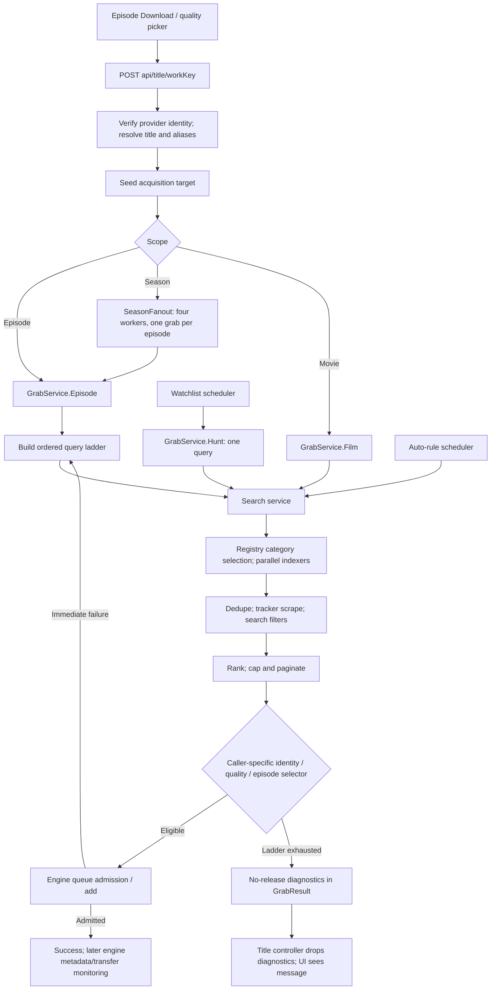

# Search-to-release matching: investigation

## Fix status (September 28, 2026)

- Live-indexer follow-up: One Piece's real AniList response contains 1,180 aired episodes, but both title projections cut the list at 200. Anime projections now preserve up to the existing AniList 5,000-episode safety bound; western placeholders remain capped at 200. Real isolated HTTP checks expose episodes 1,100 and 1,180 in both metadata and local-target lists. Three regression cases cover the provider bound and local targets. Browser verification remains blocked by Playwright MCP transport.
- FQ-DL-005: remote transfer remains blocked. Retried `https://webtorrent.io/torrents/sintel.torrent` with .NET HttpClient redirects/decompression, HTTP/1.1 and HTTP/2, OS-default TLS and explicit TLS 1.2/1.3: peer handshake failure before HTTP in every HTTPS attempt; plain HTTP returned 403. No certificate validation bypass or insecure TLS downgrade added. Error now plainly identifies the torrent host's secure-connection failure and suggests another host/magnet; failure and magnet-fallback regressions pass. This establishes the failure from this machine, not a worldwide outage.
- FQ-SET-006 (automation): fixed; `a863a9b` only handled requests. Watchlist hunts and rules now reuse its closest-quality/non-remux/smaller-known-size ordering, retaining watchlist seeder grace/floors and explicit rule filters. Four 720p/1080p tests reproduced both paths selecting huge remuxes before the change. Search page budgets are unchanged; this preference applies to returned candidates, not unseen releases.
- MAGNET-NOMETA (server): fixed; admitted magnets persist the requested name or decoded `dn` before peers supply metadata. Metadata timeout preserves that name and reports `error` with plain file-list recovery guidance; clock-driven engine/list regressions cover Unicode and explicit titles.
- UNI-007: fixed; authenticated tunnel owners can use download recovery. Middleware no longer treats recovery as local-only and controller trusts the authenticated tunnel owner role; requesters remain denied by the role-route matrix. Forwarded requests on the unauthenticated local listener remain rejected (full-suite safety regression preserved).
- MATCH-UNICODE-SLUG: fixed; a native-only identity already had a percent-encoded fallback, but lowercased comparison keys never equaled its uppercase escapes. Comparisons now normalize URI escaping/case (including route-decoded keys), preserving existing stable IDs and exact-name guards; three Japanese-only title regressions pass without requiring an invented alias.
- MATCH-APPROVAL-RESTART: fixed; startup sweep resumes approved requests with null/empty grab hashes, using a single-flight guard shared with approval. Saved hashes are never re-grabbed. Concurrent and repeat sweeps covered.
- MATCH-CONCURRENT-TARGETS: fixed; concurrent unique insert losers reuse the winning Work and AcquisitionTarget rows. HTTP regression runs 16 simultaneous grabs with and without a pre-existing Work (both failed before the fix).
- MATCH-BARE-RANGE: fixed; shared parser classifies bare numeric ranges as batches before interpreting singles, even when a stale parsed episode is supplied. The legacy TypeScript fixture incorrectly treating `Episodes 1-8` as episode 8 now has an explicit corrected expectation. Four regressions reproduced the original final-episode bug before the fix.
- MATCH-ANIME-COORDINATES: already fixed by `5c328c2`; sequel mapping regression tests rerun on main successfully.
- MATCH-QUALITY-PARSER: already fixed by `c52f4e1`; shared resolution tests include `1920x1080`.
- MATCH-SEASON-RANGE: already fixed by `c52f4e1`; spaced `S2 - 05` singles pass shared search/acquisition tests.
- MATCH-DIAGNOSTICS: already fixed by `964ecf8`; HTTP regression verifies `noReleaseFound`, the exact short message, persisted target error and grab-job message (98 matching regression cases passed together).

### Server remainder verification

Completed from isolated `fix/srv-left` worktree on September 28, 2026. Changes pushed to main; no `web/` or `ReleaseSwap*.cs` changes and no live-instance access. Final `dotnet test TorrentFlow.slnx -p:SkipWebBuild=true`: **10,152 passed, 9 skipped, 0 failed**. The existing unread-parameter warning in `FlowQaRequestSettingsTests` remains. Verification used real HTTP TestServer routes, SQLite databases, fake search/engine seams and clock-driven timeout tests; no browser verification is claimed.

| Item | Outcome / commit |
|---|---|
| MATCH-ANIME-COORDINATES | Already fixed by `5c328c2` |
| MATCH-QUALITY-PARSER | Already fixed by `c52f4e1` |
| MATCH-SEASON-RANGE | Already fixed by `c52f4e1` |
| MATCH-DIAGNOSTICS | Already fixed by `964ecf8` |
| MATCH-BARE-RANGE | Fixed by `e2bb0cd`, strengthened against stale episode hints in `2a6cdac` |
| MATCH-CONCURRENT-TARGETS | Fixed by `5e98978` |
| MATCH-APPROVAL-RESTART | Fixed by `31174db` |
| MATCH-UNICODE-SLUG | Fixed by `40888a1` |
| MAGNET-NOMETA (server) | Fixed by `6939109` |
| UNI-007 | Fixed by `941fe02`; local forwarded-request safeguard retained in `7fa5578` |
| FQ-SET-006 (automation) | Fixed by `4df1f50` |
| FQ-DL-005 | Transport still blocked by peer TLS handshake refusal from this machine; plain error/fallback regression and retry evidence in `0ef5862` |

Final review caught and corrected two integration issues before completion: the old TypeScript parity fixture encoded the bare-range bug, and the first tunnel-owner change loosened the existing local forwarded-request check. Full solution passes after both corrections.

- Episode mapping implemented: cached AniList PREQUEL traversal, explicit franchise season labels and completed-prequel totals; provider coordinates remain the persisted queue identity. Split cours do not increment the season by chain length. Ambiguous/movie/special chains and unknown totals do not receive guessed offsets.
- Parser fixes implemented: shared server episode grammar handles spaced season/dash singles, version suffixes and bracket-number fansubs; ranges/packs stay excluded. One shared resolution parser now serves Search, Library, playback and prewarm (including pixel dimensions, FHD, interlaced labels and 4k).
- Aliases implemented: AniList English/romaji/native/synonyms plus verified prequel root titles feed queries and exact title matching; distinct names replace duplicate compact spellings. Aliases persist on Works for legacy/automation callers, and request-created works retain provider identity.
- Rejection diagnostics implemented: per-candidate reason codes and source failures survive into the owner title response; counts deduplicate releases across query shapes and include search-filter rejections. The two-sentence summary persists in `GrabJob.Message` and the existing `AcquisitionTarget.Error` / request error path. Internal rejected-result pools are neither exposed by public search responses nor retained in the shared search cache.
- The investigation below remains historical evidence.

### Verification of the fix

Follow-up FQ-REQ-001: AniList placeholders now carry explicit `HasAired` evidence from FINISHED episode totals or `nextAiringEpisode - 1`. Requests accept those null-dated aired episodes, but not future/unknown schedules; western missing dates remain conservative.

Follow-up FQ-REQ-002: request-lane acquisitions try a quality-specific query first and prefer the closest eligible resolution, non-remux, then smaller known size among candidates returned. Higher quality remains allowed when the preference is unavailable; lower quality and episode packs remain excluded. This is not an arbitrary size cap or a guarantee across unseen indexer pages. The QA evidence was 13 large singles totaling ~88 GB, not an admitted season pack.

Follow-up FQ-DL-006: title GET and POST both validate a provider entry against the route's work key (canonical title or provider-supplied aliases). GET no longer shows an unrelated TVMaze show under an anime URL. POST cannot bypass verification by omitting optional title/sourceType hints, and valid AniList claims retain their provider ID for mapped season fanout. Invalid IDs are rejected, not guessed or translated across providers.

Follow-up verification: `dotnet test TorrentFlow.slnx -p:SkipWebBuild=true` passed **10,123**, skipped **9**; offline web install, typecheck and **133** web tests passed. Real request-grabber tests cover finished/releasing/future/unknown AniList entries; HTTP route tests cover rejected mismatches and mapped two-episode sequel fanout. Metadata unavailable on GET still permits local-title display, while POST rejects an unverified claim. Existing 200-episode placeholder limit is unchanged; browser verification is still outstanding due to MCP transport failure.

| Coverage | Result |
|---|---|
| Every Frieren S1 absolute episode 1–28; One Piece 1100/1180 | Table-driven exact-episode checks; neighboring episodes rejected |
| Frieren AniList sequel: provider E05, S02E05, absolute 33 | Real GrabService regression reproduces the old ten-query/zero-send failure with mapping unavailable, then admits the seeded fixture when mapping is supplied |
| Solo Leveling `S2 - 05`, Mushoku Tensei S3 / split cours | Parser and mapping tests; unknown split-cour counts do not guess a season episode |
| Bracket fansubs, `E05v2`, Shōgun/Pokémon, western S01E05 vs S01E50/S10E05 | Golden-name tests; packs/ranges remain excluded |
| AniList aliases, PREQUEL traversal, cache/single-flight, ambiguous/movie/special chains | Mock-HTTP provider tests; unavailable/ambiguous offsets fail closed |
| Real API → real search → synthetic local RSS → persisted grab failure | Port 3931 host, port 3932 synthetic indexer, data in `D:\code\memtest\match-fix\ui`; returned 409 with “12 results checked: 9 were a different episode; 3 were below 1080p”; the same message persisted on the acquisition target; **zero engine rows** |
| Web error transport | Existing title action preserves the precise two-sentence summary; typecheck and Node test suite pass |
| Browser click verification | **Blocked:** Playwright MCP `browser_navigate` and `browser_snapshot` both returned “Transport closed”; no browser interaction or payload transfer is claimed |

The synthetic RSS contained invented “Matching Verification” release names and no payload endpoint. Both QA servers were stopped afterward. Full solution / web test results are recorded in the completion report. This closes the matching slices, not the deferred shared-matcher refactor, opt-in quality fallback, explicit mapping-provider crosswalks, or source pagination/budget work.

Investigated September 28, 2026, against `6f65b0a` (`origin/main` when the detached `match-trace` worktree was created). **Investigation only; no product code changed.** Line references below describe that revision, not a promise that line numbers will survive later edits.

## Executive finding

The strongest reproduced failure is **catalog coordinates being treated as release coordinates**. AniList sequel entry `182255` is displayed as Season 1, episodes 1–10. Its available episode-five releases are parsed as **S02E05**, so the grab rejects them while searching for **S01E05**. Two 1080p releases with hundreds of advertised/live-scraped seeders survive title and quality checks, but neither is even sent to the engine. The real `GrabService` returned the reported “10 distinct query shapes” error with **zero engine calls**.

This is not a generic inability to parse absolute episode numbers. The base Frieren entry, One Piece 1100, Solo Leveling, The Bear and Dune all produced eligible candidates. A deliberate base-Frieren S01E36 search also found two eligible absolute-numbered releases. Therefore **the literal S01E36 failure was not reproduced as an unconditional failure**; the sequel-coordinate failure was. The distinction matters: do not “fix” this by loosening every title/episode check.

## Flow



The retry arrow applies to the episode ladder. Film acquisition sends only its first selected candidate.

## 1. Click, API and metadata identity

| Stage | Implementation / contract |
|---|---|
| Episode control | `web/src/components/title/episode-list.tsx:157–180`: Download opens the quality picker unless “always preferred” is set; confirmation passes the chosen resolution to the action. |
| Action dispatch | `web/src/components/title/title-detail.tsx:421–491,873–891`: forwards the episode coordinates and provider/title identity to `postTitleAction`; failure reaches `toast.error` at line 573. |
| HTTP | `web/src/components/title/title-action-request.ts:87–132`: `POST /api/title/{workKey}`, `scope:"episode"`, season, episode, title, mediaType, year, provider, providerId, sourceType, retention, preferredResolution. No torrent is chosen in the browser. Timeout is 30 seconds (`:57`); the message explicitly says the server may still be working. |
| Validation | `server/TorrentFlow.Library/Features/Titles/TitleController.cs:34–77`: requires explicit scope and positive coordinates, rejects a pinned infohash, validates quality, verifies the claimed provider ID against the work key. |
| Detail identity | `server/TorrentFlow.Library/Features/Titles/TitleService.cs:104–112,201`: provider title/type/year wins, then catalog/request/watch/local evidence. Returned aliases come **only from the supplied provider metadata**; this is not an all-provider alias union or a reload of saved `Work.AliasesJson`. |
| Resolve search aliases | `TitleController.cs:95–101` calls `EpisodeSearchIdentity.ResolveAsync`; `server/TorrentFlow.Library/Features/Grabs/EpisodeSearchIdentity.cs:21–36` does a guarded AniList lookup of at most five results if needed. It requires normalized name equality and noncontradictory year. Known anime with existing aliases returns immediately. Lookup failure silently preserves the original identity. |
| Persistence and execution | `TitleController.cs:103–154`: stores acquisition intent, calls `GrabService.Grab`, settles targets. Once seeded, the operation uses host shutdown rather than HTTP-request cancellation. |
| Branch | `server/TorrentFlow.Library/Features/Grabs/GrabService.cs:39–48`: background goes to `Hunt`, cursor goes to `Episode`, otherwise `Film`. |

### Which provider names actually reach the ladder?

* **AniList:** `server/TorrentFlow.Metadata/Providers/AniListClient.cs:26–43,161–166,251–275` requests English, romaji and native titles. Canonical title prefers English, then romaji/native; aliases contain those three distinct names. **No `synonyms`, relations, prequel/sequel IDs or episode offsets are requested.**
* **TMDB:** `server/TorrentFlow.Metadata/Providers/TmdbClient.cs:249,276` carries title/original_title/original_name, not its full alternative-title set. An exact/year-compatible AniList lookup can rescue a TMDB TV title, but it is not a cross-provider ID mapping.
* **TVmaze:** `server/TorrentFlow.Metadata/Providers/KeylessClients.cs:12–13,66–90,133–148` carries a show name, season/episode data and external IDs; the mapped `MediaMetadata` has no AKA alias list. Its `/akas` resource is not fetched here.
* **Saved works:** the title route writes aliases to `Works` (`TitleController.cs:86–88`), but scheduler and legacy on-demand callers do not subsequently pass them to `GrabService`. Release swapping does (`ReleaseSwapService.cs:60`).
* Search calls from grabs use `Enrich=false`. Rich metadata that may appear in discovery/search UI is not a later rescue step in the grab matcher.

### Catalog episode coordinates

`server/TorrentFlow.Metadata/Title/TitleExtrasService.cs:102–131` makes **every AniList media entry its own Season 1** and emits numbered placeholders without titles/air dates. Sequels have separate provider IDs but no relationship is retained in the acquisition coordinate. The cap is **200** (`:70,118`); One Piece 1100 cannot be reached through this placeholder list even though the lower-level matcher can resolve it. `TitleService.cs:165–166` also caps its local episode display at 200.

TVmaze uses actual season/episode numbers (`TitleExtrasService.cs:159–180`); TMDB uses its season endpoint with count-based placeholders only on failure (`:208–226`). This explains why ordinary western-series coordinates fit scene releases more often.

History: `1d3d180` introduced the AniList numbered Season 1 list; `8608671` introduced the .NET episode ladder, alias recovery and parser parity. These are separate, locally sensible features without a coordinate translation contract between them.

## 2. Query construction: what “10 distinct query shapes” means

`server/TorrentFlow.Library/Features/Grabs/EpisodeLadder.cs:33–58` creates up to six title variants: original, parenthesized-year removal, spaced-dash head, colon-to-space/removal, alphanumeric form and compact/no-space form. `AliasTitleForms` (`:65–83`) additionally accepts a comma head if it has at least two words and six characters. It deliberately does not reduce `Re:...` to `Re`.

`RankAliases` (`:87–96`) orders by a heuristic cost: non-Latin penalty, punctuation penalty, no-space penalty, camel-case penalty and length. `BuildEpisodeRungs` (`:119–194`) separates genuine “rescue” names from punctuation spellings, but only chooses **bestAlias and secondAlias**. Compact spellings can occupy both effective rescue slots: in the run, `SousounoFrieren` was used while other provider names were never searched. All generated title forms remain accepted by the final title check.

Order, with duplicate `(category, lowercased query, filters)` combinations removed:

1. Canonical `Title SxxEyy` in primary category.
2. If a rescue alias exists: its scene query in anime/primary, its absolute query in anime, absolute plus selected quality, canonical `season x episode` alternative, and rescue absolute in primary.
3. Without a rescue: canonical `1x05`/`2x03`, scene query in anime, absolute in anime.
4. Second alias scene query in anime/primary, then absolute in anime.
5. Best alias (or canonical) scene and absolute in the extra `all` category.
6. Final **zero-seeder** scene query in anime (or primary), not a zero-seeder absolute query.

Exact formatting comes from `server/TorrentFlow.Library/Features/Watchlist/EpisodeCursor.cs:8–10` and `EpisodeLadder.cs:151–164`:

* Scene: `S01E05`; alternate: `1x05`.
* “Absolute”: `Title - 05`, **only when requested season == 1**, and uses the local episode value unchanged.
* Quality narrowing: `Title - 05 1080p` when a rescue alias exists; it is not a fallback to 720p. No separate year is appended. A year already embedded in the title can be retained or removed by title variants.
* Normal filters: magnet required, minSeeders=1, requested episode; scene/alternate also include requested season. Final relaxed query uses minSeeders=0.
* Category order: primary (`anime`, `tv`, `movies`), anime when not already primary, then all (`:107–115`). Actual queries deduplicate repeated categories.

**Ten is not a hard limit or ten independent algorithms.** It is `memo.Count` for the searches actually executed (`GrabService.cs:56–88`), keyed by query/category/filter values. Same query in a different category or with minSeeders=0 counts again. Runs produced 10 rungs for Frieren/Solo Leveling, 8 for One Piece and 7 for The Bear. A successful first send ends the ladder early.

## 3. Indexers, ordering, timeouts and pagination

`server/TorrentFlow.Core/Sources/SourceRegistry.cs:64–81` loads embedded defaults plus the isolated data directory's `sources.json`, orders priority then ID, and filters enabled sources by normalized category. `server/TorrentFlow.Search/Adapters/RegisteredTorrentSources.cs:11–46` selects implementations and tries configured mirrors. **There is no sequential “try Nyaa, then TPB” fallback across sources**: `TorrentSearchService.cs:111–138` starts selected adapters concurrently.

Default source inventory (`server/TorrentFlow.Core/Sources/sources.default.json:2–8`):

| Source | Categories relevant here | Priority | Source deadline | State |
|---|---|---:|---:|---|
| Nyaa | anime; also included in `all` | 10 | 12 s | enabled |
| ApiBay / ThePirateBay | anime, series, movie | 20 | 12 s | enabled |
| TorrentsCSV | anime, series, movie | 30 | 12 s | enabled |
| YTS | movie | 40 | 15 s | enabled; three configured endpoints |
| EZTV | series | 50 | 15 s | enabled; three configured endpoints |
| 1337x | anime, series, movie | 60 | 20 s | disabled by default |
| Internet Archive | anime, series, movie | 70 | 15 s | disabled by default |
| Torznab | configured source categories | configurable | configurable | implementation supported; no default source row |

Thus anime uses Nyaa/ApiBay/CSV, TV uses ApiBay/CSV/EZTV, movies use ApiBay/CSV/YTS, and all includes the five enabled torrent sources. Registry priority controls enumeration, not completion order; same-hash dedupe keeps the first listing with maximum seen peer counts.

HTTP adapter mechanics (`server/TorrentFlow.Search/Adapters/TorrentAdapters.cs`):

* ApiBay `:46–64`: `/q.php?q=...&cat=...`; most video queries use category 0 then local TV/movie category filtering.
* CSV `:68–85`: query/size search, at most 50 adapter results.
* Nyaa `:88–109`: RSS, anime category `1_0`, all `0_0`; reads infohash, magnet/torrent link, size and advertised seeders. It takes the first result page; no historical pagination.
* YTS `:112–143`: title search, sorted by seeds; multiple encodes per movie; no requested year in the HTTP query.
* EZTV `:150–237`: derives show/IMDb identity (normally exact-name TVmaze lookup), requests **page 1, limit 100**, filters requested scene coordinates, then takes the adapter limit. Older episodes can be absent from that page. `ShowTitle`/`EpisodeFromQuery` recognize S/E but not the ladder's `2x03` spelling consistently.
* 1337x `:241–281`: optional HTML search plus per-result detail requests, at most four detail fetches simultaneously; optional browser fallback. Not enabled in this run.
* Archive/Torznab are implemented in `Adapters/ArchiveAdapter.cs` and `Adapters/TorznabAdapter.cs`; neither was active or claimed as tested.

Timeout layers:

* `SourceExecution.RunAsync` (`SourceRegistry.cs:193–205`) encloses a source/mirror attempt set in its source deadline.
* `IndexerHttp.cs:12–47,53–103`: HTTP default 12 s, 8 MiB response bound; mirror preferences and five-minute failure demotion. Some adapters set smaller/larger inner timeouts. Named HttpClient is 40 s (`SearchModule.cs:17`).
* Process-wide adapter lifetime 180 s, 24 concurrent adapters and 64 concurrent searches (`SearchModuleOptions.cs:10–15`; `TorrentSearchService.cs:194–201`).
* **Interactive search HTTP endpoint** adds a 6 s adapter wait budget (`SearchController.cs:44–46`). **GrabService does not set that override**, so a preview through `/api/search` is not exactly the same timeout policy as an acquisition.
* Tracker scrape budget: 1.8 s interactive, 3.5 s background, up to 60 hashes (`TorrentSearchService.cs:151–178`).
* Search budget: **40 foreground / 15 background searches per minute**, not per title (`SearchCacheStore.cs:46–56`). The long diagnostic sweep hit this; see run limitations.

Each source is asked for 50–80 results, even when the caller asks for fewer (`TorrentSearchService.cs:109–110`). The service deduplicates, scrapes, filters, ranks, **then truncates to caller Limit**, and subsequently paginates (`:74–83,140–148`). Episodes explicitly set Limit=PageSize=40. Films set Limit=20; scheduler hunts set Limit=15. Relevant old singles can still be lost upstream or after ranking; “40 fetched” is not an exhaustive source search.

## 4. Parsing and eligibility

### Episode/release parsing

The search parser is `server/TorrentFlow.Search/EpisodeParser.cs:36–105`. Ordered branches:

1. `2nd Season - 05`; optionally an explicit `episode/ep/absolute episode N` supplies `AbsoluteEpisode`.
2. Season ranges/lists.
3. Complete/batch/season-pack words.
4. `S02E05` or `2x05`.
5. Episode/ep/e plus a number, optionally with a season.
6. Dash plus number, followed by recognized quality, brackets, extension or end.
7. Fansub-prefixed bare 3–4 digit episode, with year/title-number safeguards.
8. Bare season => pack; otherwise unknown.

Ordinary `- 36` goes into **Episode=36, Season=null**, not `AbsoluteEpisode=36`. No provider mapping is consulted. Only the ordinal branch reads an explicit alternative absolute label; the acquisition matcher **does not compare that field**.

`EpisodeLadder.MatchesTargetEpisode` (`:198–205`) rejects batch, season pack, multi-season and recognized episode ranges; then requires **Episode equality** and **Season equality**, except seasonless releases can satisfy **target Season 1 only**. Separate range detection is in `Library/Features/Grabs/ReleaseNames.cs:122–131`. Packs are intentionally never promoted to an episode candidate.

Concrete parser defects seen in the run:

* `... S2 - 05 ...` and `... Season 2 - 05 ...` can hit the **season-range branch first**, becoming an S02–S05 pack, not S02E05. A real Solo Leveling CSV result used that spelling.
* `[Title][36][1080p]` is not a recognized absolute spelling; real high-ranked Frieren 36 results returned `Episode=null`.
* The search filter tolerates **unknown** parsed season/episode, but rejects a **known mismatch** (`server/TorrentFlow.Search/SearchFilters.cs:47–55`). Consequently unsupported names consume ranked-pool space until the stricter grab selector rejects them.

### Title “similarity”: there is no fuzzy acceptance threshold for grabs

Do not confuse discovery relevance with acquisition identity:

* Search ranking: `ReleaseQuality.RelevanceTier` (`server/TorrentFlow.Search/ReleaseQuality.cs:126–138`) gives 3 for normalized substring, 2 if all query tokens occur, 1 if at least half occur, else 0. **Ranking signal, not a candidate acceptance threshold.**
* Episode acquisition: `EpisodeLadder.ReleaseMatchesWork` (`:209–213`) cleans the release into an identity and requires a work-key match against accepted title forms. `Library/Features/Grabs/ReleaseNames.cs:302–325,334–369` strips release noise/episode structure, folds/slugifies the name, and compares keys, with legacy-key/yearless compatibility. This is exact normalized identity, **not edit distance/Dice >= X**.
* Scheduler: `ReleaseSelection.SameWork` (`:54–59`) uses its own simpler CleanTitle+Normalize equality. This can disagree with the episode ladder.
* Metadata artwork selection has a different algorithm: `server/TorrentFlow.Metadata/Artwork/ArtworkResolver.cs:47,136–185`: exact=100, article-equivalent=72, accepted subtitle=80, otherwise token Dice ×70; accepted at 60 after year adjustment in artwork selection. That threshold does **not** choose a torrent for Download.

### Quality

`GrabService.cs:45`: kept acquisition floor = explicit request, else client preferredResolution, else **1080**. Streaming has no floor. UI default is also 1080 (`web/src/components/title/use-preferred-quality.ts:20–40`); settings and each Download quality picker can change it to 480/720/1080/2160 (`TitleController.cs:55–58`).

`ReleaseSelection.Resolution/MeetsFloor` (`:42–47`) recognizes only 480p/720p/1080p/2160p or bare 4k. Unknown/lower resolutions are rejected; **no below-floor fallback exists**, even in the relaxed rung.

Search scoring uses a richer parser (`ReleaseQuality.cs:13–30`): 1920x1080/FHD/1080i/1440p etc. A controlled `Solo Leveling S01E05 1920x1080` was scored as 1080 but rejected by the grab parser as unknown. A real `Ore Dake ... 05 (BS11 1920x1080 MPEG2 TS)` was rejected on this floor. Higher eligible resolution is allowed; ranking is not a global “exhaust all 1080 before any 2160” pass across rungs.

### Seeders, health, exclusions, “working”

* Normal episode candidates require a magnet and seeders >0; the last rung allows 0 and sorts by seeders (`EpisodeLadder.cs:217–225`). Torrent-URL-only candidates are filtered out despite the engine supporting torrent URLs.
* Same-hash and normalized-title/size duplicate listings are collapsed (`ReleaseRanking.cs:51–64`). Cross-rung attempted hashes/magnets/IDs are excluded for this call only (`GrabService.cs:57–78`).
* Unsafe executable names are filtered (`SearchFilters.cs:12,36–55`). Pack/range checks are hard exclusions for episode acquisition. CAM/junk, implausible size, extras and specials are mostly **ranking penalties**, not a blanket hard deny in this selector (`ReleaseRanking.cs:76–86`).
* Public tracker scraping adjusts seeders; a zero scrape demotes non-Nyaa to at most one seeder, rather than declaring DHT-only swarms dead. Nyaa advertised counts are trusted (`TorrentSearchService.cs:151,185–191`). No scrape response preserves listed counts.
* **No swarm peer probe or file metadata validation is part of episode candidate selection.** `SwarmHealth` exists but is not injected into `GrabService`. `GrabService.Send` (`:175–233`) calls the engine and treats successful admission as a working send.
* Engine may fetch a supplied `.torrent`, dedupe, check paths/storage/queue admission, then start or queue (`server/TorrentFlow.Engine/TorrentEngineService.cs:103–182`). Kept downloads **do not wait for magnet metadata** (`:157–160`). A later monitor can time out metadata (`:1328–1331`, default 90 s at `EngineOptions.cs:58`). This investigation did not start payload downloads or validate peer transfer.
* Prior failed-release exclusions are not global to ordinary grabs. Manual release replacement has its own persistent `ReleaseAttempts`/existing-engine exclusions (`ReleaseSwapService.cs:54–56,108–129`).

## 5. Picking the winner and reporting failure

`server/TorrentFlow.Search/ReleaseRanking.cs:65–111` scores, in descending significance: extras suppression, category, title relevance, junk/size plausibility, swarm class (dead / 1–9 / >=10 seeders), resolution affinity, swarm-size bucket, direct-playability, language and recency. Final ties consider episode ordering, seeder bucket and size.

`GrabService.Episode` takes the **first ranked eligible candidate in the earliest successful rung**, not the best candidate across every alias/query. It attempts another candidate/rung only after an immediate send failure. If exhausted:

* any send failure => returns the last send failure and `reason:"send_failed"`;
* no attempted candidate => logs the generic “Couldn't find a working release…” and `reason:"no_release"`;
* source failures can therefore look like absent content: episode failure does not use the film source-outage message;
* thrown throttling is not a normal empty ladder result; the title controller catches it as a 500 body (`TitleController.cs:140–152`), whereas `/api/search` explicitly returns 429.

Diagnostics are partially implemented: `RungDiagnostic`/`NoReleaseFound` includes query/category/minSeeders/fetched/workEligible/qualityEligible/attempted (`GrabService.cs:23–34,68–90`). **It has no episode-eligible count, source errors, per-candidate reasons, or elapsed stage timings.** The reproduced case says 6 work-eligible, 2 quality-eligible, 0 attempted without explaining the coordinate mismatch.

Worse, `TitleController.cs:167–169` constructs a reduced response **without `NoReleaseFound`**, and the season response retains only error messages (`:155–165`). `LogSkip` stores a message rather than the full report. The browser's `throwGrabFailure` only receives a message. There is no initial-grab “Why no release?” screen or first-class no-download diagnostics endpoint. `/api/search` is a partial preview; the replacement endpoint requires an existing download and has different exclusions.

## 6. Season, movie, scheduler and other paths

| Path | Shared pieces | Divergence |
|---|---|---|
| Episode Download | Search/ranker, EpisodeLadder, GrabService.Send | Multi-query rescue ladder, exact work/episode, hard quality floor. |
| Season Download | Same Episode branch per episode | `TitleController.cs:136`, `SeasonFanout.cs:37–70`: four concurrent workers, no packs, partial successes; each episode may consume a full ladder and the shared search-rate budget. |
| Movie Download | Search/ranker, Send | `GrabService.cs:94–112`, `FilmSelection.cs:11–64`: one title-only query, 20 results, exact work/year, no episode/pack, seeded magnet, floor; first candidate only, no alias ladder or send retry. All-source outage is distinguished from no release. |
| Legacy watchlist on-demand | Same GrabService.Episode | `OnDemandController.cs:25–46`: title/cursor from row/request, but no provider lookup/aliases/year passed. |
| Monitored scheduler | Same GrabService, search and exact-episode helper | `AutomationService.cs:153`, `GrabService.cs:115–172`: **one** SxxEyy query, 15 results, background budget, no alias recovery. Different exact title cleaner. Default minimum seeders 3 with 360-minute grace, then can send low/zero-seeder candidate (`AutomationOptions.cs:7–10`). |
| Cursor after misses | Separate watchlist cursor policy | `EpisodeCursor.cs:28–30`: after three misses at episode >1 can jump to next season E1. Floor-only misses do not advance (`GrabService.cs:126,169`), but identity/coordinate misses can. No season boundary mapping. |
| Auto-rules | Search/ranker/engine only | `AutomationService.cs:48–104`: category/minimum seeders/size and **exact** resolution string, first result; no shared work/episode acquisition selector or ladder. |
| Approved requests | GrabService and season fanout | `server/TorrentFlow.Api/Requests/RequestGrabber.cs:26–58`: no alias recovery; only episodes with known aired dates qualify. AniList placeholder air dates are null, so request approval can find no aired episodes even though direct Download searches them. |
| Manual replacement | Reuses ladder and episode identity helpers | `ReleaseSwapService.cs:62–92,108–129`: stops at first rung with alternatives, persistent exclusions, requires compatible hash and magnet; has separate selection orchestration. |
| Playback and prewarm | Same search contract, separate selection | `server/TorrentFlow.Media/Playback/Releases.cs:211–250`, `Features/Prewarm/PreRanker.cs:68–112`: independent floor/title/episode rules and stored swarm verdict preferences. Seasonless absolute episodes are not accepted as S1 by these exact season comparisons. |

## 7. Duplicate/inconsistent logic

Inventory of the release matching/parsing family in the inspected server and web tree (not unrelated JSON/subtitle parsers):

| Concern | Implementations |
|---|---|
| Full episode-name parsing | `server/TorrentFlow.Search/EpisodeParser.cs:36`; `server/TorrentFlow.Library/Features/Grabs/ReleaseNames.cs:59`; `server/TorrentFlow.Metadata/Browse/ReleaseNames.cs:32`; `server/TorrentFlow.Media/Common/Episodes.cs:15`; `server/TorrentFlow.Media/Features/Prewarm/ReleaseText.cs:199–218` (another independent shape-only parser, not a wrapper); `web/src/lib/torrents/episodes.ts:355`. |
| Narrow/adapter episode parsing | `Library/Features/Watchlist/EpisodeCursor.cs:14` only S/E; `Search/Adapters/TorrentAdapters.cs:157–172` EZTV query parser; `Library/Features/Titles/TitleService.cs:220–258` local pack/multi-season/year helpers; `Engine/Layout/ContentLayoutPolicy.cs:49–77` layout episode-key extraction. `web/src/lib/library/cursor.ts` also has cursor logic. These are not an episode-mapping service. |
| Work identity/cleaning | `Search/WorkIdentity.cs:68,89` (`WorkIdentityParser.Parse/Matches`); `Library/Features/Grabs/ReleaseNames.cs:302–369`; `Metadata/Browse/ReleaseNames.cs:239`; `Library/Features/Grabs/ReleaseSelection.cs:11–40,54`; `Media/Features/Prewarm/ReleaseText.cs:98`; `Media/Playback/Releases.cs:217`; `Engine/Layout/ContentLayoutPolicy.cs:136` has a separate exact-token folder-release comparison; `web/src/lib/torrents/work-identity.ts:317`; `web/src/components/title/work-key.ts:79`. |
| Resolution parsing | `Search/ReleaseQuality.cs:13`; `Library/Features/Grabs/ReleaseSelection.cs:42`; `Media/Playback/Releases.cs:77`; `Media/Features/Prewarm/ReleaseText.cs:32`; `web/src/lib/torrents/quality.ts:65`. Library's small parser demonstrably disagrees with search's richer one. |
| Candidate selection | EpisodeLadder.Select, FilmSelection.Select, GrabService.Hunt, AutomationService.Rules, ReleaseSwapService.Select, Media.Playback.Releases.SelectBestRelease, Media.Prewarm.PreRanker.SelectBestRelease. |
| Additional normalization/ranking | EpisodeLadder.NormalizeTitle vs ReleaseSelection.Normalize/CleanTitle vs Search.ReleaseQuality.NormalizeTitle; Search.ReleaseRanking versus Media's verdict/resolution ordering; artwork/discovery matching is yet another policy and must not silently become acquisition matching. |

The Library/Metadata parser comments explicitly explain that copies were made because modules do not reference each other. Avoid “solving” this with circular project references: a shared, dependency-neutral Core matching contract/implementation is the natural consolidation point. The UI still needs parsing for display; it should receive canonical parsed fields from the API where possible, and otherwise share golden fixtures with the server.

Specific inconsistencies reproduced or directly traced:

1. AniList local S1 vs parsed sequel S2 (live failure).
2. `S2 - 05` misclassified as a season range (controlled fixture **and real CSV release**).
3. 1920x1080 is rankable as 1080 yet below/unknown to the grab floor (controlled and live).
4. Scene and ordinal/absolute names are parsed, but there is no mapping between their coordinate systems.
5. Search UI metadata/relevance can say “this work”; strict acquisition identity can still reject it.
6. Alias availability differs between title Download, watchlist, scheduled hunts and requests.
7. Search rank accepts/lower-ranks below-floor candidates, acquisition rejects them; final low-seed relaxation never relaxes quality or adds absolute zero-seed queries.
8. Existing diagnostics disappear at the title-controller boundary and omit the very episode-match gate responsible for the failure.

## 8. Live reproduction and evidence

### Isolation and method

* Detached worktree: `D:\code\platformApps-worktrees\match-trace`.
* Requested `ASPNETCORE_URLS=http://127.0.0.1:3930`, `TorrentFlow__DataDirectory=D:\code\memtest\match-data`, `TorrentFlow__Library__DisableScheduler=true`; `dotnet run --project server\TorrentFlow.Api --no-launch-profile -p:SkipWebBuild=true`.
* **3930 was already owned by PID 27528.** The attempted host failed with address-in-use. That unrelated process was not stopped. The isolated host was restarted on **3939**, inside the permitted range; `/api/health` returned 200.
* A disposable .NET 10 console harness referenced the real Search/Library/Metadata projects, loaded real AniList metadata, wrapped the configured adapters to capture their outputs, and invoked the production `TorrentSearchService`, `EpisodeLadder` and `FilmSelection`. It used the same 1080 floor, filters, limits, categories and tracker scraper. It did not register/start a torrent engine or hosted background workers.
* Adapter wrapper counts are **raw adapter output before search dedupe/scrape/filter/rank**, not the full unbounded remote catalog nor wire rows discarded inside an adapter. Top-five raw and ranked names were inspected with production identity/floor/episode functions; no magnets or hashes are retained in this document.
* To inspect every rung, the harness deliberately continued after finding an eligible candidate. **Production would stop after its first successful send.** Source results/seeders change over time; the numbers below are a dated sample, not a benchmark.
* Final confirmation called the **real `GrabService.Grab`** with a DispatchProxy `ITorrentEngine` that refused every possible acquisition, using the actual registered search service and isolated DB. AniList sequel S01E05 returned `no_release`, 10 searches, **AddAsync calls=0**. Thus no transfer was initiated and the failure is pre-engine.
* Raw diagnostic sweep exceeded the 40-search foreground budget after The Bear's first two rungs. Remaining queries were reported throttled, not empty. The Bear and Dune were rerun in a fresh harness scope, completing normally; the table uses that completed rerun.
* This is acquisition-resolution verification, not browser UX or successful torrent-transfer verification. No browser click or copyrighted payload download was necessary or claimed.

Reproduction recipe without changing application code: compose `AddTorrentFlowData`, `AddSearchModule`, `AddMetadataModule` against a dedicated data directory; resolve AniList metadata; call `BuildEpisodeRungs`; run each rung with the exact `SearchOptions` from `GrabService.Episode`; preserve `SearchResponse.Sources`; run `ReleaseMatchesWork`, `MeetsFloor`, `MatchesTargetEpisode`/`Select`; replace `ITorrentEngine` with a fail-closed fake before invoking `GrabService`. Do **not** use the title POST as a dry run: it has no dry-run flag.

### Cases

| Case | Verified provider identity | Resolution outcome |
|---|---|---|
| Frieren S01E05 | AniList 154587; English + `Sousou no Frieren` + native; 28 episodes | First rung: 3 returned, all 3 eligible. |
| Frieren sequel S01E05 | AniList 182255; `Frieren: Beyond Journey’s End Season 2`, `Sousou no Frieren 2nd Season`, native; 10 episodes | All 10 rungs: zero eligible. Real GrabService reproduces the generic error; 2 1080 candidates rejected solely by season mismatch. |
| One Piece S01E1100 | AniList 21; canonical `ONE PIECE`; current API count 1180 | First rung: 2 returned, 1 eligible; absolute rung: 12 eligible. UI placeholder cap still prevents navigating to E1100. |
| Solo Leveling S01E05 | AniList 151807; `Solo Leveling`, `Ore dake Level Up na Ken`, native; 12 episodes | First rung: 31 returned, 21 eligible. Also surfaces sequel/range and quality-parser issues. |
| The Bear S02E03 | Explicit western-series control, title `The Bear`, year 2022 | First rung: 31 returned, 9 eligible. Other Bear titles correctly fail identity. |
| Dune (2021) | Explicit movie control, work key `dune-2021` | 20 returned, 7 eligible; top Dune Part Two results correctly rejected. |
| Extra: base Frieren S01E36 | Same names as 154587; intentionally outside its 28-episode catalog count | Absolute rung: 14 returned, 2 eligible. Not proof that this is a valid catalog episode or that every S01E36 fails. |
| Extra: sequel S01E08 | Same identity as 182255 | 10 rungs, zero eligible; 1080 S02E08 candidates rejected despite 768 / 115 adjusted seeders. |

AniList search ordering itself is not a season mapping: the query returned the third-season entry before the second-season entry. The test explicitly chose ID **182255**, not “the second search result.”

### All query shapes and raw per-indexer counts

Abbreviations: N=Nyaa, A=ApiBay, C=TorrentsCSV, Y=YTS, E=EZTV. A dash means not selected; zero means the selected adapter returned zero without error. Every source status in the completed rows below had **no reported error**. `R/E` = post-search returned / eligible at 1080. `low` means minSeeders=0; other rows use 1. Exact/alternate filters include target season+episode; dash-number queries include only episode.

| Case | Query | Category | N/A/C/Y/E | R/E |
|---|---|---|---|---|---|
| Frieren 5 | `Frieren: Beyond Journey’s End S01E05` | anime | 1/0/3/–/– | 3/3 |
| | `Sousou no Frieren S01E05` | anime | 13/0/0/–/– | 12/10 |
| | `Sousou no Frieren - 05` | anime | 48/50/22/–/– | 40/7 |
| | `Sousou no Frieren - 05 1080p` | anime | 30/29/10/–/– | 28/6 |
| | `Frieren: Beyond Journey’s End 1x05` | anime | 0/0/0/–/– | 0/0 |
| | `SousounoFrieren S01E05` | anime | 0/0/0/–/– | 0/0 |
| | `SousounoFrieren - 05` | anime | 0/0/0/–/– | 0/0 |
| | `Sousou no Frieren S01E05` | all | 13/0/0/0/0 | 12/10 |
| | `Sousou no Frieren - 05` | all | 50/50/22/0/0 | 40/7 |
| | `Sousou no Frieren S01E05` | anime low | 13/0/0/–/– | 13/10 |
| Sequel 5 | `Frieren: Beyond Journey’s End Season 2 S01E05` | anime | 0/0/0/–/– | 0/0 |
| | `Sousou no Frieren 2nd Season S01E05` | anime | 0/0/0/–/– | 0/0 |
| | `Sousou no Frieren 2nd Season - 05` | anime | 6/0/3/–/– | 6/0 |
| | `Sousou no Frieren 2nd Season - 05 1080p` | anime | 2/0/1/–/– | 2/0 |
| | `Frieren: Beyond Journey’s End Season 2 1x05` | anime | 0/0/0/–/– | 0/0 |
| | `SousounoFrieren2ndSeason S01E05` | anime | 0/0/0/–/– | 0/0 |
| | `SousounoFrieren2ndSeason - 05` | anime | 0/0/0/–/– | 0/0 |
| | `Sousou no Frieren 2nd Season S01E05` | all | 0/0/0/0/0 | 0/0 |
| | `Sousou no Frieren 2nd Season - 05` | all | 6/0/3/0/0 | 6/0 |
| | `Sousou no Frieren 2nd Season S01E05` | anime low | 0/0/0/–/– | 0/0 |
| One Piece | `ONE PIECE S01E1100` | anime | 3/0/0/–/– | 2/1 |
| | `ONE PIECE 1x1100` | anime | 0/0/0/–/– | 0/0 |
| | `ONE PIECE - 1100` | anime | 33/50/14/–/– | 40/12 |
| | `ONEPIECE S01E1100` | anime | 0/0/0/–/– | 0/0 |
| | `ONEPIECE - 1100` | anime | 0/23/0/–/– | 1/0 |
| | `ONE PIECE S01E1100` | all | 3/0/0/0/0 | 2/1 |
| | `ONE PIECE - 1100` | all | 35/50/14/0/0 | 40/11 |
| | `ONE PIECE S01E1100` | anime low | 3/0/0/–/– | 3/1 |
| Solo | `Solo Leveling S01E05` | anime | 16/16/9/–/– | 31/21 |
| | `Ore dake Level Up na Ken S01E05` | anime | 12/0/0/–/– | 11/9 |
| | `Ore dake Level Up na Ken - 05` | anime | 27/22/8/–/– | 21/7 |
| | `Ore dake Level Up na Ken - 05 1080p` | anime | 18/2/7/–/– | 12/7 |
| | `Solo Leveling 1x05` | anime | 0/0/0/–/– | 0/0 |
| | `OredakeLevelUpnaKen S01E05` | anime | 0/0/0/–/– | 0/0 |
| | `OredakeLevelUpnaKen - 05` | anime | 0/0/0/–/– | 0/0 |
| | `Ore dake Level Up na Ken S01E05` | all | 12/0/0/0/0 | 11/9 |
| | `Ore dake Level Up na Ken - 05` | all | 27/22/8/0/0 | 21/7 |
| | `Ore dake Level Up na Ken S01E05` | anime low | 12/0/0/–/– | 12/9 |
| Bear | `The Bear S02E03` | tv | –/37/5/–/0 | 31/9 |
| | `The Bear 2x03` | tv | –/0/0/–/0 | 0/0 |
| | `The Bear S02E03` | anime | 0/37/5/–/– | 31/9 |
| | `TheBear S02E03` | anime | 0/0/0/–/– | 0/0 |
| | `TheBear S02E03` | tv | –/0/0/–/0 | 0/0 |
| | `The Bear S02E03` | all | 0/37/5/0/0 | 31/9 |
| | `The Bear S02E03` | anime low | 0/37/5/–/– | 38/9 |
| Dune | `Dune` | movies | –/50/25/45/– | 20/7 |

Extra S01E36 used the exact ten Frieren-5 shapes above with `05` replaced by `36` and `1x05` by `1x36`. Only three rows returned anything:

| Query/category | N/A/C/Y/E | R/E |
|---|---|---|
| `Sousou no Frieren - 36`, anime | 21/50/0/–/– | 14/2 |
| `Sousou no Frieren - 36 1080p`, anime | 17/29/0/–/– | 13/2 |
| `Sousou no Frieren - 36`, all | 21/50/0/0/0 | 14/2 |

Extra sequel08 used the exact ten sequel-5 shapes with `05` replaced by `08` and `1x05` by `1x08`. Only three returned anything:

| Query/category | N/A/C/Y/E | R/E |
|---|---|---|
| `Sousou no Frieren 2nd Season - 08`, anime | 6/0/4/–/– | 6/0 |
| `Sousou no Frieren 2nd Season - 08 1080p`, anime | 2/0/2/–/– | 2/0 |
| `Sousou no Frieren 2nd Season - 08`, all | 6/0/4/0/0 | 6/0 |

All other extra-run rows had zero raw results from every selected adapter. This is **not** the same as the throttled rows in the first sweep.

### Top-result decisions

Names below retain enough distinguishing text to identify the observed row; omitted suffixes are marked `…`. “Eligible” means selection passed, **not** a verified downloadable swarm. Raw-adapter rows may be absent from the final ranked pool after seeder/coordinate filtering or dedupe.

| Case / observed result | Decision |
|---|---|
| Frieren first-rung #1 `Frieren - Beyond Journey’s End S01E05 MULTi 1080p … Tsundere-Raws …` | Eligible; exact work/episode and floor. |
| #2 `www.UIndex.org - Frieren Beyond Journeys End S01E05 REPACK 1080p … Kitsune` | Eligible; site-prefix cleanup succeeds. |
| #3 `[Yameii] Frieren - Beyond Journey's End - S01E05 v2 … 1080p …` | Eligible; all three first-rung results passed. |
| Sequel dash-05 #1 `[Erai-raws] Sousou no Frieren 2nd Season - 05 [1080p CR WEB-DL AVC AAC]…` | 265 adjusted seeders; title/floor pass; parsed S02E05 != target S01E05. |
| #2 same title `[1080p CR WEBRip HEVC AAC]…` | 181 adjusted seeders; same season mismatch. |
| #3 same title `[720p CR WEB-DL AVC AAC]…` | 24 seeders; below floor **and** season mismatch. |
| #4 same title `[480p CR WEB-DL AVC AAC]…` | 5 seeders; below floor **and** season mismatch. |
| #5 `[shincaps] … 2nd Season - 05 (BS-NTV 1440x1080 MPEG2 AAC).ts` | Unknown grab resolution **and** season mismatch. The AT-X raw counterpart fails identically. |
| One Piece first-rung #1 `One Piece S01E1100 VOSTFR 1080p … Tsundere-Raws` | Eligible, 1 adjusted seeder. |
| #2 same episode `720p …` | Below the 1080 floor. |
| Solo first-rung #1 `[LostYears] Solo Leveling - S01E05 (WEB 1080p …) [Dual-Audio] …` | Eligible. |
| #2 `Solo Leveling S01E05 DUBBED 1080p WEB H264-SKYANiME` | Eligible. |
| #3 `Solo Leveling S01E05 VOSTFR 1080p … Tsundere-Raws …` | Eligible; French language is not a hard exclusion. |
| #4 `[Tenrai-Sensei] Solo Leveling - S01E05 - A Pretty Good Deal … [1080p] …` | Eligible. |
| #5 `[Yameii] Solo Leveling - S01E05 … [CR WEB-DL 720p] …` | Below floor. |
| Solo raw `[Erai-raws] Ore dake Level Up na Ken Season 2 - 05 [1080p CR WEB-DL …]…mkv` (CSV, 34 listed seeders) | Parsed as S02–S05 multi-season pack; rejected as pack, not tested as an episode. |
| Solo raw `[New-raws] Ore dake Level Up na Ken -ARISE FROM THE SHADOW- - 05 [1080p] [AMZN].mkv` | Work identity differs from first-season aliases. This is not evidence that every alias mismatch should be accepted. |
| Solo `[shincaps] Ore Dake Level Up na Ken - 05 (BS11 1920x1080 MPEG2 TS).ts` | Episode/title pass; grab resolution unknown, while search quality parser recognizes 1080. |
| Bear first-rung #1 `The Bear S02E03 Sundae 1080p HULU … NTb` | Eligible. |
| #2 `The.Bear.S02E03.Sundae.1080p.DSNP.…NTb[TGx]` | Eligible. |
| #3 `The Bear S02E03 1080p WEB h264-EDITH` | Eligible. |
| #4 `The Bear S02E03 MULTI 1080p WEB H264-HiggsBoson` | Eligible. |
| #5 another `The Bear S02E03 Sundae 1080p HULU … NTb` listing | Eligible; separate ranked listing, not proof that text identity alone dedupes all torrents. |
| Bear raw `The Island with Bear Grylls S02E03 … 1080p …`, `Ronja the Robbers Daughter … S02E03 Bear Cavern …`, `Kuma Kuma Kuma Bear S02E03 …` | Correctly rejected as other works; matching episode coordinates alone is unsafe. |
| Bear raw `The Bear S02E03 720p HEVC x265-MeGusta` | Below floor. |
| Movie #1 `Dune Part Two (2024) [1080p] [WEBRip] 88` | Different work/year; correctly rejected. |
| #2 `Dune (2021) [1080p] [WEBRip]` | Eligible; first film winner if engine admission succeeds. |
| #3 `Dune Part Two (2024) [1080p] [BluRay]` | Different work/year. |
| #4 `Dune (2021) [1080p] [BluRay]` | Eligible. |
| #5 `Dune.Part.Two.2024.1080p.WEBRip.1600MB.…GalaxyRG` | Different work/year. |
| S01E36 #1/#2 `【喵萌奶茶屋】…[葬送… / Sousou no Frieren][36][1080p]…` | Work identity **and** episode parse fail. |
| #3 `[喵萌奶茶屋&LoliHouse] 葬送的芙莉莲 / Sousou no Frieren - 36 [WebRip 1080p …]…` | Eligible; conventional dash-number is understood. |
| #4/#5 `[北宇治字幕组] 葬送的芙莉莲 / Sousou no Frieren [36][WebRip][1080p]…` | Episode unknown; bracket-only 36 is not understood. |
| Sequel08 first five: Erai 1080 AVC, 1080 HEVC, 720, 480; shincaps 1440x1080 | All parse S02E08, not local S01E08. First two otherwise pass; latter three also fail floor. |

### Real GrabService failure record

```text
Input: AniList 182255 title/aliases, local S01E05, keep, preferredResolution=1080
Ok=false; NoReleaseFound.reason=no_release; searches=10; triedSeasonPacks=false
Engine AddAsync calls=0
Sousou no Frieren 2nd Season - 05:
  fetched=6, workEligible=6, qualityEligible=2, attempted=0
Sousou no Frieren 2nd Season - 05 1080p:
  fetched=2, workEligible=2, qualityEligible=2, attempted=0
Message:
Couldn't find a working release for S01E05 at 1080p or higher after 10 distinct
query shapes. Try again in a bit — another eligible release may show up.
```

## Why S01E36 fails

The message groups multiple causes together; it does **not** mean ten healthy-release checks failed:

1. **Untranslated numbering is the proven systemic failure.** The service cannot equate S01E36, S02E08 and absolute 36. The live sequel entry fails for both local E05 and E08 while corresponding S02 releases exist. A controlled `Sousou no Frieren S02E08 1080p` fails a target S01E36; `… - 36 (1080p)` passes it. The base entry contains 28 episodes, so “36 = 28 + 8” is an illustrative offset, not an offset the current app knows or validates.
2. **Naming grammar can hide actual candidates.** Live bracket-only `[36]` names were unparsed; `S2 - 05` was parsed as a multi-season pack. More queries do not repair those downstream rejections.
3. **Names/aliases are incomplete and caller-dependent.** Two effective rescue slots and punctuation-only variants waste query budget; no synonyms or provider crosswalk; scheduler/request callers omit known aliases. This is a traced limitation, not the cause of the live sequel failure where workEligible=6.
4. **The hard floor excludes lower/unknown formats, including a parser disagreement.** A 1920x1080 live release can rank as 1080 but fail acquisition. The reproduced sequel still had two 1080 survivors, so lowering the floor alone would **not** fix its season mismatch.
5. **Pagination, source failure and throttling are conflated or underexplained.** Bounded source pages/ranked caps are not exhaustive; source errors are omitted from episode diagnostics; the sweep actually hit the foreground budget. These are contributing failure mechanisms, not evidence that this run had an indexer outage.
6. **“Working” overstates the evidence.** Zero attempted candidates can emit this wording; successful admission does not establish a peer transfer. There is no persisted/UI-visible explanation of which gate rejected the release.

**Counterevidence retained:** base Frieren S01E36 had two eligible absolute releases in this run. We cannot attribute the owner's historical exact S01E36 toast to a particular provider/title/quality/source state without a per-grab record.

## Recommended fixes

Effort: S = localized change/tests; M = several components/contracts; L = data model/provider integration and migration/regression work. These are recommendations, not approved implementation changes.

| Priority | Change | Effort | Acceptance / safeguards |
|---|---|---|---|
| P0 | Introduce an explicit episode identity/mapping contract: provider entry + local episode + canonical season/episode + absolute/scene alternatives. Translate **before both query building and candidate matching**. | L | AniList sequel local E05 resolves to appropriate S02E05/absolute alternative, without treating unrelated S1E5 as interchangeable. Keep mapping provenance/confidence and support split cours, specials and overrides. |
| P0 | Fix `S2 - 05`/`Season 2 - 05` ambiguity and bracket-number fansub forms with one shared golden corpus; preserve real multi-season/range rejection. | M | Real captured names and negative pack cases; no broad “ignore season” shortcut. |
| P0 | Reject **bare episode ranges** (`001-366`, `01-36`) before extracting their final number. | S/M | Follow-up captured a real Bleach series range admitted as E366. Test both parser copies, actual GrabService, and the legitimate single `- 36` control. |
| P0 | Make Work/target creation concurrency-safe and coalesce the same acquisition intent. | M | Concurrent different episodes of a new work and ten rapid repeats must not produce unique-key 500s. Preserve intentional retries and engine-level hash deduplication. |
| P0 | Add a persisted per-grab diagnostics record and UI **“Why no release?”**. Expose the already-computed report now, then add reason-coded rejection details. | S for response plumbing; M for full record/UI | Query, aliases/provenance, mapped coordinates, per-source raw counts/errors/deadlines, stage counts including episodeEligible, candidate reasons, floor, seeders, attempts, timings and correlation ID. Separate outage/throttle/no-match/send failure and still-running. Redact magnets/paths appropriately by role. |
| P1 | Consolidate release parsing, quality and work/episode matching in a dependency-neutral shared component consumed by Download, movie, scheduler, rules where appropriate, replacement and playback/prewarm. | L | Same input/canonical identity produces the same eligibility explanation; policy differences are explicit options, not copied implementations. Shared fixtures for display TS. |
| P1 | Gather and persist provider-linked aliases: AniList synonyms plus English/romaji/native; TMDB alternate names; TVmaze AKAs. Use them in all callers and prioritize distinct names over compact duplicates. | M | Alias provenance and work/season identity remain constrained; no fuzzy cross-franchise acceptance. Recovered aliases survive catalog reload and scheduler execution. |
| P1 | Canonicalize escaped work keys consistently, including fully non-Latin titles. | S | The exact Japanese-only title must match itself; current lowercased key aliases disagree with uppercase percent escapes generated by `Uri.EscapeDataString`. |
| P1 | Persist resumable acquisition jobs, including approved requests interrupted before a hash is saved. | M | Restart must resume or explicitly fail approved/no-hash work; the current fulfillment sweep only checks approved rows that already have hashes. |
| P1 | Build anime mapping from verified provider crosswalks and anime-lists/TheXEM-style explicit mappings; use AniList prequel/sequel relations and counts only as evidence for offsets, never blind summation. | L | Distinguish continuity from compilation/remake/side-story; unknown counts/ambiguous cours do not auto-map. Cache/version mappings and permit owner correction. AniList IDs require a crosswalk to mapping-provider IDs. |
| P1 | Unify quality parsing immediately and offer an **explicit opt-in** “best available below floor” action with a clear toast (“No 1080p release; download 720p instead?”). | M | Current AGENTS contract makes selected quality a hard minimum. Do not silently violate it or auto-advance monitored cursors on a fallback. Unknown quality is not automatically a safe lower-quality release. |
| P2 | Give query planning a total budget and source-aware pagination; favor distinct aliases/mapped coordinates over repeated no-space/category shapes. Carry retry-after to the UI and coordinate season fanout with rate limits. | M | Do not convert rate limits/timeouts into empty results; inspect older EZTV/Nyaa pages within budget; reproduce with a season larger than four episodes. |
| P2 | Clarify “selected/admitted” versus “peer-verified”; attach bounded health evidence if a future policy requires “working”. Share failed-release exclusions/recovery deliberately. | M | A zero-candidate failure never implies a peer test; queue admission is not transfer success; bounded probes never start unapproved payload acquisition. |

Mapping-source design references checked during this investigation: AniList's Media schema exposes `synonyms` and `relations` (`https://docs.anilist.co/reference/object/media`); its relation-aware query guide is `https://docs.anilist.co/guide/graphql/queries/media`. The anime-lists schema documents explicit season/episode-offset mappings (`https://github.com/Anime-Lists/anime-lists`), and the AniList-ID crosswalk/mapping project is `https://github.com/Fribb/anime-lists`. Sonarr's primary `XemService` implementation illustrates separate scene season/episode/absolute fields and marked unverified extrapolations (`https://raw.githubusercontent.com/Sonarr/Sonarr/develop/src/NzbDrone.Core/DataAugmentation/Xem/XemService.cs`). These are proposed inputs/design references, not dependencies currently used by TorrentFlow, and no unverified automatic offset should be installed merely because two entries are sequels.

## Verification boundary

Production .NET projects built successfully as dependencies of the diagnostic harness. The isolated host answered health checks; live metadata/indexer calls, actual parser/selector evaluation and a no-send real GrabService failure were verified. The requested six cases plus S01E36/sequel08 controls were covered. No runtime fix, browser UI behavior, successful download, third-party source availability guarantee, or exhaustive future naming compatibility is claimed. The investigation server was stopped, port 3939 was confirmed no longer listening, the disposable harness/logs were removed, and `D:\code\memtest\match-data` was deleted and confirmed absent. The unrelated 3930 listener was left untouched. Only this document is committed.

## Expanded verification — September 28, 2026

The owner expanded the brief after the initial publication. This follow-up tested the
`a853be5` worktree, not a modified matcher. Times below are local UTC+03:00.
The initial trace above remains anchored to its stated revision; the additional
source anchors below refer to this follow-up revision.

**This is not an exhaustive green sign-off.** The live corpus and controlled
negative/concurrency coverage were expanded substantially, but browser execution
was blocked: Playwright MCP returned **`Transport closed`** on both owner and
requester navigation attempts. A successful web build or HTTP response is not
substituted for clicking the UI. Untested cross-products are explicitly blocked
below rather than counted as passes.

### Method and evidence strength

* **Live:** 13 additional title/episode cases, **60 actual search rungs** through
  the registered Search module, real AniList metadata, source reports, ranking,
  and production Library eligibility functions. Stopped each case at its first
  eligible rung, or exhausted its ladder. No engine was registered for this run.
* **Controlled:** a disposable console harness referenced the actual Library/API
  test fixtures and production services. It recorded **88 flow/input/repetition
  cases**, **29 validation/restart/identity observations**, **55 role/approval
  observations** (including a final-state summary), **8 parser/admission
  probes**, and **42 additional six-flow edge/repetition cases**. Those are
  observation counts, not 222 independent passing tests.
  Search and engine boundaries were fake; database, controllers, matcher, grab,
  authorization and request decisions were real.
* **Existing regressions:** Library **165 passed**; Search **8,302 passed,
  1 skipped**; frontend Node suite **91 passed**. The skipped public-tracker
  smoke requires `TF_NETWORK_TESTS=1`. The Archive smoke also returns without
  networking unless opted in, so its green result is not live Archive evidence.
* **Build:** current worktree TypeScript and Vite production build passed.
  Initial pnpm restore attempts failed first on a corporate-registry 404 and
  then public-registry TLS handshakes. A public-registry npm restore using
  `--ignore-scripts --no-package-lock` succeeded; no dependency manifest or
  lockfile change is part of this investigation.
* **Sockets/restart:** a real HTTP proxy to the fake-engine production test host
  used owner/requester ports 3930/3931. Four acquisition requests were interrupted
  only after the diagnostic endpoint confirmed four searches and five persisted
  queued targets. A different process claimed 3930 before restart; it was left
  untouched. The isolated host was restarted on free ports 3937/3932 against the
  same QA database. No request to any unrelated host initiated acquisition.
* **No misleading download claim:** a fake `AddAsync` success proves selection
  and admission plumbing only. Fixtures deliberately reused a hash; 500 fake
  adds do not mean 500 distinct real downloads, and repeated adds do not prove
  the real engine would duplicate a torrent.

Commands used from the detached worktree:

```powershell
dotnet test server\tests\TorrentFlow.Library.Tests -p:SkipWebBuild=true
dotnet test server\tests\TorrentFlow.Search.Tests -p:SkipWebBuild=true
# In web:
npm install --ignore-scripts --no-package-lock --registry=https://registry.npmjs.org
npm run build
node --test tests/*.test.mjs
```

The disposable harness used `LibraryHost`, `FakeSearch`, and `FakeEngine` from
`server/tests/TorrentFlow.Library.Tests/TestHost.cs:16–55`, plus the test RSA key
source and connection-port startup filter from
`server/tests/TorrentFlow.Api.Tests/RemoteAccessTests.cs:23–54`. All harness data
was under the detached worktree. No full API/Metadata suite was blindly run:
several fixtures default to system temporary paths, and one remote test starts
arbitrary real sockets. The role harness instead supplied explicit local data
paths and permitted HTTP ports.

### Additional confirmed findings

1. **A complete bare range can be selected as one episode — P0.**
   Live Bleach E366 returned
   `[pursua] Bleach 001-366 (R2J DVD, JPN BD 1080p)`.
   The production parser reported `Episode=366`, `Season=null`, `IsBatch=false`,
   `IsSeasonPack=false`; the range guard returned false. Actual `GrabService`
   with that captured release returned `Ok=true` and called the fake engine
   once. The same happened for `Example Show 001-036 (1080p)` and
   `Example Show 01-36 [1080p]`; the single `Example Show - 36 [1080p]`
   correctly passed as the control. `DashEpisode` consumes the final number
   (`ReleaseNames.cs:36,110–111`); the range guard only recognizes scene/cross/
   episode-word prefixes (`ReleaseNames.cs:125–133`), and
   `EpisodeLadder.cs:199–205` trusts it. **Bleach's “eligible” live result below
   is therefore a failed safety test, not a successful exact-episode grab.**
2. **Concurrent new title/target creation returns real 500s.**
   Two concurrent different episodes of a previously unknown work yielded
   **200/500**. Ten simultaneous same-target submissions yielded four 200s
   and six 500s in this run. Logs contained SQLite unique violations for
   `Work.workKey` and `AcquisitionTarget.userId, AcquisitionTarget.targetKey`.
   `TitleController.cs:83–90,112–125` performs read-then-insert without conflict
   recovery. In contrast, `RequestGrabber.cs:62–81` explicitly recovers a raced
   Work insertion. Sequential double submit and two simultaneous same-episode
   submits both returned 200/200 with two fake engine adds and one target:
   no HTTP-level single-flight was demonstrated. Real engine hash deduplication
   remains a separate concern.
3. **Exact non-Latin names can fail identity matching.**
   `日本語のタイトル S01E01 1080p` had the correct parsed episode and quality but
   `ReleaseMatchesWork(..., ["日本語のタイトル"])` returned false. Its work key
   was an uppercase percent-escaped string. `KeyAliases` lowercases that key,
   while `WorkKeyMatches` compares it ordinally with freshly generated
   uppercase escapes (`ReleaseNames.cs:340–366`). Pokémon and Shōgun correctly
   fold to `pokemon`/`shogun` and pass. This is distinct from the legitimate
   rejection of Pokémon *sequel/spinoff* releases in the live corpus.
4. **Approval restart has an unresumed pre-hash state.**
   `ApproveAsync` persists approved, then starts an in-memory task
   (`RequestDecisionService.cs:45–62`). The sweep filters to approved rows with
   nonnull hashes (`RequestDecisionService.cs:141–149`). A persisted
   approved/no-hash interrupted-state fixture remained approved with zero adds
   after the real `SweepAsync`; existing approved rows with hashes survived
   restart. This proves the sweep gap, not full crash recovery of real torrents.
5. **More release noise leaks into movie identity.**
   The live 4K Spider-Man top result passed quality but became
   `Spider-Man: No Way Home Ultra HD 10-bit`, so it failed work identity.
   A Spirited Away 1080p result with an unmatched parenthesis became
   `Spirited Away RM ( 7 1 Japanese Garshasp`. These are further reasons a
   single shared, tested parser matters; a fuzzy “accept anything similar”
   workaround would be unsafe.

These findings are logged separately as `MATCH-BARE-RANGE`,
`MATCH-CONCURRENT-TARGETS`, `MATCH-UNICODE-SLUG`, and
`MATCH-APPROVAL-RESTART`. They remain open; no product fix was made.

### Live title coverage

PASS means an eligible candidate was observed, **not** downloaded or peer-proven.
FAIL means no eligible candidate was observed, or a safety false positive was
found; lack of availability by itself is not asserted to be a code defect.
`returned/eligible` counts are after Search's dedupe, filtering and cap.

| Content type | Case | Result | Evidence |
|---|---|---|---|
| Movie | Dune (2021) | PASS | First rung 20/6; other-year/Part Two results rejected. |
| Movie | Spider-Man: No Way Home (2021) | PASS | 20/15; two top-five rejections explained above/below. |
| Movie | Spirited Away (2001) | PASS | 20/9; malformed release noise caused one top-five identity rejection. |
| Western series | The Bear S02E03 | PASS | 31/9 on first rung. |
| Western series | Shōgun (2024) S01E05 | PASS | 7/3; accent folding works; lower/unknown/noisy releases rejected. |
| Western series | Severance S01E01 | PASS | 28/10 on first rung. |
| Long-running anime | One Piece, AniList 21, E1100 | PASS | 2/1 on first rung; the API exposes 1,180 episodes in this run. |
| Long-running anime | Naruto, AniList 20, E220 | FAIL | Ten rungs exhausted; packs, different works and lower-quality results; no eligible single. Metadata count 220. |
| Long-running anime | Bleach, AniList 269, E366 | **FAIL** | Absolute rung 30/2 but a real 001–366 range was falsely accepted. Metadata count 366. |
| Long-running anime | Pokémon, AniList 527, E05 | FAIL | Ten rungs; returned Pocket Monsters sequels/spinoffs failed base-work identity. Metadata count 276. |
| Sequel anime | Frieren 2, AniList 182255, local S01E05 | FAIL | Ten rungs; two otherwise eligible 1080 S02E05 releases rejected. Metadata count 10. |
| Sequel anime | Solo Leveling 2, AniList 176496, local S01E05 | FAIL | Ten rungs; native-title rescue produced broad unrelated results; remaining titles failed identity. Metadata count 13. |
| Sequel anime | Slime 3, AniList 156822, local S01E05 | FAIL | Ten rungs; four 1080 results rejected on episode coordinates (S03 versus local S01). Metadata count 24. |

The initial Frieren base/Solo Leveling base/Bear/Dune/S01E36/sequel08 controls
above remain additional observations. This follow-up supplies at least three
distinct titles in each requested content class; it does **not** claim that
every title was tested through every UI, role, scheduler, season and restart
combination.

### Controlled flow coverage matrix

For the first table, **each row was exercised separately through all five
columns**, with fresh isolated fixture state. PASS on a rejection means the
specified ineligible release was not sent. HTTP-status inconsistencies are
preserved rather than hidden. Hunt is the background `GrabService` branch;
the following regression table separately covers the real scheduler.

| Case | Title episode | Season (3 singles) | Film | Legacy on-demand | Background Hunt |
|---|---|---|---|---|---|
| Eligible 1080 | PASS 200; 1 add | PASS 200; 3 adds | PASS 200; 1 add | PASS 200; 1 add | PASS; 1 add |
| Empty results | PASS 409; 10 queries | PASS 409; 30 queries | PASS 409; 1 query | PASS 502; 10 queries | PASS false; 1 query |
| Wrong work | PASS 409 | PASS 409 | PASS 409 | PASS 502 | PASS false |
| Wrong episode/season; film given series-shaped name | PASS 409 | PASS 409 | PASS 409 | PASS 502 | PASS false |
| Explicit batch/season pack | PASS 409 | PASS 409 | PASS 409 | PASS 502 | PASS false |
| Explicit S01E01–E03 range | PASS 409 | PASS 409 | PASS 409 | PASS 502 | PASS false |
| Only 720, floor 1080 | PASS 409 | PASS 409 | PASS 409 | PASS 502 | PASS false |
| Unknown quality | PASS 409 | PASS 409 | PASS 409 | PASS 502 | PASS false |
| Only 2160, floor 1080 | PASS 200 | PASS 200 | PASS 200 | PASS 200 | PASS true |
| Zero seeders | PASS relaxed rung; 10 queries | PASS 30 queries | PASS rejects | PASS relaxed rung | Admits: fixture has no WatchListItemId, so no seeder-wait state |
| No magnet field, valid hash retained | PASS rejects | PASS rejects | PASS rejects | PASS rejects | Admits; different defensive assumption, not a live-source failure proof |
| Source report says unreachable, no rows | **FAIL diagnosis:** ordinary no-release | **FAIL diagnosis:** ordinary no-release | **PASS diagnosis:** explicitly says outage, not missing release | **FAIL diagnosis:** ordinary no-release | **FAIL diagnosis:** no-release report |
| Search throws | 500 | 409; each sibling attempted | 500 | 500 | Exception propagated |
| Engine add fails | PASS failure; 1 attempt across ladder | PASS failure; 3 attempts | PASS failure; 1 attempt, no next-film retry | PASS failure 502 | PASS false |
| Engine reports storage cap | 409 with storage result | 409 | 409 | 507 | false |
| No configured client | 409, no adds | 409, no adds | 409, no adds | 502, no adds | false, no adds |

The thrown-search and storage rows record observable contracts, not a blanket
claim that every status is desirable. Soft source outages are demonstrably
conflated with absence. Some fixture inputs intentionally violate upstream
Search filtering assumptions; those are boundary tests, not claims about
normal adapters. Hunt deliberately accepts a valid hash/torrent URL without a
magnet (`GrabService.cs:130–132`); its seeder wait only runs when a watch row is
supplied (`GrabService.cs:139–157`). The movie outage message is a useful existing
behavior to share with the other matchers, not replace.

| Input / state / interaction | Result | Evidence |
|---|---|---|
| Missing/unknown scope | PASS | 400, zero adds. |
| Negative season, zero/string episode, episode plus episode-list | PASS | Each 400, zero adds. |
| Empty season, movie with episode coordinates, pinned infohash | PASS | Each 400, zero adds. |
| Invalid 1440 quality / failed claimed provider identity | PASS | Each 400, zero adds. |
| Null quality | PASS | Configured 1080 floor used; eligible release admitted. |
| 500-character title / 501-character title | PASS validation boundary | 500 accepted (existing route key resolved canonical Example Show); 501 rejected 400. This is not proof the supplied long title was searched. |
| 10,000-character title | PASS | 400 before search, `title must be at most 500 characters`. |
| Empty/whitespace owner title with nonempty route key | PASS fallback | Canonical title derived from route key; not an empty query sent to providers. |
| Pokémon, Shōgun, Spider-Man punctuation, Frieren apostrophe, `A & B / C ? #` | PASS controlled matching | Each exact fixture returned 200 and one fake add. |
| Fully Japanese title | **FAIL** | Correct episode/floor, exact-name work match false; API 409. |
| `int.MaxValue` episode | **FAIL validation gap** | Accepted as coordinates, then ten futile shapes and 409; parser supports only 1–4 episode digits. |
| Duplicate season episode list `[1,1,2,2]` | PASS | Deduped to two targets/two fake adds. |
| 501 requested season episodes | PASS bounded execution; truncation caveat | First 500 processed, 500 fake adds; response total 500. Extra episode silently dropped by `Take(500)`, not explicitly rejected. |
| Sequential double episode submit | No HTTP coalescing | 200/200, two fake adds, one target; real torrent dedupe not tested. |
| Two concurrent same episode submits | No HTTP coalescing | 200/200 in this run, two fake adds, one target. |
| Two concurrent different episodes of new work | **FAIL** | 200/500; Work unique-key race. |
| Ten rapid same-target submits | **FAIL** | Four 200/six 500; Work/target unique-key races. |
| Bare `001-366`, `001-036`, `01-36` ranges | **FAIL** | Three actual GrabService probes each returned true and called fake engine. |
| Valid `- 36` single control | PASS | Same service correctly admits one exact episode. |
| Process stopped with episode, season, film and on-demand searches in flight | PASS interruption/durability; recovery BLOCKED | Four searches observed, zero adds; five title targets queued before kill and after restart. Hosted workers deliberately removed; this does not verify full production recovery. |

#### Cross-flow edge/repetition sweep

A second, fresh-fixture sweep applied **all seven cases to all six flows**
(42 cases). Unlike the isolated Hunt branch above, the scheduler column invokes
the real `AutomationService.Run`; rules invoke `AutomationService.Rules`.
Every case ran to its observed outcome, including after failures.

| Case | Episode | Season, 3 episodes | Film | Legacy on-demand | Scheduler | Rules |
|---|---|---|---|---|---|---|
| Empty title/query | PASS route-key fallback, 200 | PASS fallback, 200 | PASS fallback, 200 | PASS rejects 400 | Seeded invalid empty-title row tolerated; 1 fake add | PASS create rejects 400 |
| Pokémon | PASS 200 | PASS 200 | PASS 200 | PASS 200 | PASS 1 fake add | PASS 1 fake add |
| Frieren apostrophe/colon | PASS 200 | PASS 200 | PASS 200 | PASS 200 | PASS 1 fake add | PASS 1 fake add |
| 10,000 characters | PASS rejects 400 | PASS rejects 400 | PASS rejects 400 | PASS rejects 400 | Directly seeded oversized row tolerated; 1 fake add | PASS create rejects 400 |
| Sequential double submit/run | 200/200, 2 adds | 200/200, 6 adds | 200/200, 2 adds | 200/200, 2 adds | PASS 1 send + 1 skip | PASS 1 send + 1 skip |
| Two concurrent submits/runs | **FAIL** 500/200 | **FAIL** 200/500 | **FAIL** 200/500 | 200/200, 2 adds | PASS 1 send + 1 skip | PASS 1 send + 1 skip |
| Ten rapid submits/runs | **FAIL** 1 success/9 failures | **FAIL** 1 success/9 failures | **FAIL** 1 success/9 failures | Ten 200s, 10 adds | PASS 1 send + 9 skips | PASS 1 send + 9 skips |

Scheduler empty/huge rows were deliberately seeded below the HTTP validation
boundary; those results are not evidence that the normal watchlist-create API
accepts invalid input. The fake hash is constant across episodes/runs:
rule/scheduler skips prove their recorded-match dedupe, not peer behavior.
Different failure counts across the two repetition sweeps are expected race
timing variability; both expose the same Work/target insertion defect.
Season repeats also demonstrate that “do not downgrade a settled target” does
not itself skip re-invoking the grab for each requested episode.

### Roles, requests, stale state and restarts

| Case | Result | Evidence / boundary |
|---|---|---|
| Local owner `/api/me`; signed requester `/api/me` | PASS | Correct owner/local and requester/tunnel roles. Test RSA assertion, not actual Cloudflare infrastructure. |
| Expired assertion: me, title, owner requests, own requests, alternatives | PASS | All five returned 401 with re-sign-in message. |
| Requester reads title/own requests | PASS | 200; owner `/api/requests` and release alternatives denied 403. |
| Requester directly acquires episode, season or film | PASS | All three denied 403 before acquisition. |
| Owner calls requester-only create/list area | PASS | 403 requester-only; owner uses normal acquisition route. |
| Request movie / immediate duplicate | PASS | 201 then 409 duplicate. |
| Another requester cancels someone else's request | PASS | 404; no ownership leak. |
| Requester approves request | PASS | 403. |
| Owner approves with no release | PASS state transition | Immediate 200 approved, later persisted failed; zero release adds for this case. Immediate response is not completed acquisition. |
| Owner approves eligible fake movie | PASS | Immediate approved; hash persisted and one fake add. Still approved, not fulfilled, because no transfer completion occurred. |
| Repeat approval / cancel approved request | PASS | 409 not-pending. |
| Decline / repeat decline / nonexistent approval | PASS | 200 / 409 / 404. |
| Request title empty, whitespace, 10,000 chars | PASS | 400; request title limit 300, unlike title-route limit 500. |
| Request Pokémon, Shōgun, Spider-Man, Frieren, Japanese title | PASS create validation only | Each 201; fake metadata IDs deliberately used. Not evidence of actual download matching. |
| Missing/bad provider, bad scope, negative seasons, unknown field | PASS | Five separate 400 responses. |
| Simultaneous duplicate creates, existing request | PASS | 409/409. |
| Simultaneous first creates of same new request | PASS | 201/409, one request row. |
| Cancel pending / repeat cancel | PASS | 200/409. |
| Movies-only auto-approval | PASS | Movie auto-approved with persisted hash/fake add; series request remained pending. |
| Restart with previously approved/hash-bearing rows | PASS persistence | Another Film and Auto Film retained approved plus their hashes in the reopened database. Real completion reconciliation not claimed. |
| Restart after approval persisted but before hash | **FAIL recovery sweep** | Controlled interrupted-state row remained approved, zero adds after actual SweepAsync. |
| Actual completion/fulfillment / all-downloads UI / GB totals | BLOCKED | Fake engine performs no transfer; Playwright MCP unavailable. |
| Approval of three real series/anime season sets, with airdate/provider failures | BLOCKED | Not dynamically exercised through every request-provider combination; null-airdate filtering remains a source-traced finding. |

### Scheduler, rules, replacement: regression-backed coverage

All named tests below passed in the 165-test Library run. They are controlled
tests, not live scheduler acquisitions. Paths are under
`server/tests/TorrentFlow.Library.Tests/`.

| Flow / case | Result | Executed tests |
|---|---|---|
| Scheduler happy exact episode and cursor movement | PASS | `AutomationTests`, `RouteTests`: exact send, cursor only forward. |
| Scheduler lower/unknown quality versus true absence | PASS | `OnlyRealAbsenceCountsAsHuntMiss`; sub-floor/unknown pins cursor. |
| Scheduler seeders, timeout, future/unknown airdate, expired/disabled grace | PASS | `AutomationTests`, `CheckScheduleTests`: configurable grace; six-hour timeout; future airdate no search; metadata failure fallback. |
| Scheduler two runs / subset / disabled interval / due spacing | PASS | `ExistingRunLockSkipsSecondRun`, `SubsetRespectsDueStateAndRunLock`, `DisabledIntervalDoesNotRunEvenWhenWoken`, `DueItemsAreSeriallySpacedAndFutureItemIsNotSearched`. |
| Rules empty result, malformed scope, anime/live-action, failed send retry/dedupe | PASS | `RulesCrudAndNoMatchRun`, `StrictRulesRejectLiveActionForAnime`, `RuleFailureDoesNotPoisonSuccessfulMatchDedupe`. |
| Season ready sends, blocked search, sibling errors, four-worker cap, ordering | PASS | `AllReadyEpisodesSendBeforeTheFirstSendFinishes`, `DeadSearchCannotBlockWholeSeason`, `FailedSearchReleasesLaterSend`, `PoolNeverExceedsFourWorkers`, `FanoutKeepsResultsOrderedAndQueuedHonestWithoutSerializingSends`. |
| Stale/settled targets; client disconnect | PASS | `SeasonRetryResetsOnlyFailedTargetsAndNeverDowngradesSettledOnes`, `LinkedTorrentOutsideScanWindowIsNotMarkedFailed`, `ClientDisconnectStillSettlesTheAcquisition`. |
| Replacement happy choices, wrong work/quality/pack/current/tried/duplicate exclusions | PASS | `ReleaseSwapTests`: `PreservesSearchRankingAndExcludesCurrentTriedDuplicateWrongWorkAndQuality`, `EpisodeNeverSwitchesSeasonOrAcquiresPack`. |
| Replacement missing/current-gone, invalid/expired/bound token | PASS | `HttpContractDistinguishesEmptyMissingInvalidAndExpired`, `HttpContractExposesRankedChoicesAndAcceptsOnlyBoundTokens`; separate requester denial tested above. |
| Replacement restart/concurrent token consumption | BLOCKED | Not exercised dynamically in this follow-up; do not infer it from expiry tests. |
| Scheduler/rules restart during an in-flight add | BLOCKED | No fake-engine scheduler process interruption test was completed; request sweep and HTTP-target durability are different cases. |
| Playback/prewarm equivalent eligibility and every media/codec error | BLOCKED | Static duplicate inventory above only; broad playback verification would require separate media fixtures and browser availability. |

### UI coverage — explicitly blocked, not waived

| Role / CSS width | Episode / season / film | Requests / approval | Scheduler / rules / replacement / playback | Reason |
|---|---|---|---|---|
| Owner / 390 | BLOCKED | BLOCKED | BLOCKED | Playwright MCP navigation failed `Transport closed`; no rendered next-state assertion or screenshot. |
| Owner / 1280 | BLOCKED | BLOCKED | BLOCKED | Same unavailable MCP transport. |
| Requester / 390 | BLOCKED | BLOCKED | BLOCKED (owner-only actions still denied in API tests) | Requester navigation also failed `Transport closed`. |
| Requester / 1280 | BLOCKED | BLOCKED | BLOCKED (same API boundary) | Same unavailable MCP transport. |

Consequently UI double clicks, rapidly repeated controls, stale screens,
in-flight navigation/reload, restart reconnection, overflow at both widths,
toast wording/rendering, and “Why no release?” interactions are **BLOCKED**.
No ad-hoc Playwright/Puppeteer script was substituted. The absence of a per-grab
diagnostics UI is independently established by the traced API/component contract.

The complete Cartesian product of every title, flow, error, role, width,
concurrency ordering and restart point was **not completed** within this bounded
investigation. This table is the remaining coverage debt, not a claim that the
owner's exhaustive-testing requirement has been satisfied.

### Follow-up live query ledger

All 60 completed rungs are recorded below, in execution order within each case.
`N/A/C/Y/E` means **Nyaa / ApiBay / torrents-csv / YTS / EZTV** source-report
counts before merged-result filtering/capping; `–` means not queried. Sources
run in parallel, so the column order is not a sequential dispatch order.
No completed source report contained an error in this sweep. A foreground
rate-limit exception was separately observed; the harness respected
`RetryAfterSeconds` and retried rather than counting that as an empty rung.

`R/P` = returned / production-eligible; **P is not necessarily safe**, as the
Bleach range probe demonstrated. Top-five first-failure gates:
`W` work identity, `Q` quality, `E` episode/season/pack, `I` combined film
identity/shape/floor, `✓` eligible. Counts sum to at most five. These are
diagnostic evaluations, not a new matching algorithm. Repeated query text in
the last rung uses the relaxed zero-seeder filter.

| Case | Exact query | Category | N/A/C/Y/E | R/P | Top-five gates |
|---|---|---|---|---|---|
| Dune | `Dune` | movies | –/50/25/45/– | 20/6 | I3, ✓2 |
| Spider-Man | `Spider-Man: No Way Home` | movies | –/50/25/8/– | 20/15 | I2, ✓3 |
| Spirited Away | `Spirited Away` | movies | –/50/25/4/– | 20/9 | ✓4, I1 |
| Bear | `The Bear S02E03` | tv | –/37/5/–/0 | 31/9 | ✓5 |
| Shōgun | `Shōgun S01E05` | tv | –/0/1/–/7 | 7/3 | W1, ✓3, Q1 |
| Severance | `Severance S01E01` | tv | –/33/5/–/0 | 28/10 | ✓4, Q1 |
| One Piece | `ONE PIECE S01E1100` | anime | 3/0/0/–/– | 2/1 | ✓1, Q1 |
| Naruto | `Naruto S01E220` | anime | 0/9/0/–/– | 0/0 | — |
| Naruto | `NARUTO ナルト S01E220` | anime | 0/9/0/–/– | 0/0 | — |
| Naruto | `NARUTO ナルト - 220` | anime | 4/50/0/–/– | 17/0 | W5 |
| Naruto | `NARUTO ナルト - 220 1080p` | anime | 2/50/0/–/– | 7/0 | W5 |
| Naruto | `Naruto 1x220` | anime | 0/0/0/–/– | 0/0 | — |
| Naruto | `NARUTO -ナルト- S01E220` | anime | 0/9/0/–/– | 0/0 | — |
| Naruto | `NARUTO -ナルト- - 220` | anime | 50/50/0/–/– | 34/0 | E1, W2, Q2 |
| Naruto | `NARUTO ナルト S01E220` | all | 0/9/0/0/0 | 0/0 | — |
| Naruto | `NARUTO ナルト - 220` | all | 4/50/0/0/0 | 17/0 | W5 |
| Naruto | `NARUTO ナルト S01E220` | anime | 0/9/0/–/– | 9/0 | W5 |
| Bleach | `Bleach S01E366` | anime | 0/0/0/–/– | 0/0 | — |
| Bleach | `Bleach 1x366` | anime | 0/0/0/–/– | 0/0 | — |
| Bleach | `Bleach - 366` | anime | 50/50/3/–/– | 30/2 | W2, E2, ✓1 unsafe |
| Pokémon | `Pokémon S01E05` | anime | 0/1/0/–/– | 0/0 | — |
| Pokémon | `Pocket Monsters S01E05` | anime | 0/0/0/–/– | 0/0 | — |
| Pokémon | `Pocket Monsters - 05` | anime | 50/27/2/–/– | 6/0 | W5 |
| Pokémon | `Pocket Monsters - 05 1080p` | anime | 15/1/1/–/– | 1/0 | W1 |
| Pokémon | `Pokémon 1x05` | anime | 0/0/0/–/– | 0/0 | — |
| Pokémon | `PocketMonsters S01E05` | anime | 0/0/0/–/– | 0/0 | — |
| Pokémon | `PocketMonsters - 05` | anime | 0/0/0/–/– | 0/0 | — |
| Pokémon | `Pocket Monsters S01E05` | all | 0/0/0/0/0 | 0/0 | — |
| Pokémon | `Pocket Monsters - 05` | all | 50/27/2/0/0 | 6/0 | W5 |
| Pokémon | `Pocket Monsters S01E05` | anime | 0/0/0/–/– | 0/0 | — |
| Frieren 2 | `Frieren: Beyond Journey’s End Season 2 S01E05` | anime | 0/0/0/–/– | 0/0 | — |
| Frieren 2 | `Sousou no Frieren 2nd Season S01E05` | anime | 0/0/0/–/– | 0/0 | — |
| Frieren 2 | `Sousou no Frieren 2nd Season - 05` | anime | 6/0/3/–/– | 6/0 | E2, Q3 |
| Frieren 2 | `Sousou no Frieren 2nd Season - 05 1080p` | anime | 2/0/1/–/– | 2/0 | E2 |
| Frieren 2 | `Frieren: Beyond Journey’s End Season 2 1x05` | anime | 0/0/0/–/– | 0/0 | — |
| Frieren 2 | `SousounoFrieren2ndSeason S01E05` | anime | 0/0/0/–/– | 0/0 | — |
| Frieren 2 | `SousounoFrieren2ndSeason - 05` | anime | 0/0/0/–/– | 0/0 | — |
| Frieren 2 | `Sousou no Frieren 2nd Season S01E05` | all | 0/0/0/0/0 | 0/0 | — |
| Frieren 2 | `Sousou no Frieren 2nd Season - 05` | all | 6/0/3/0/0 | 6/0 | E2, Q3 |
| Frieren 2 | `Sousou no Frieren 2nd Season S01E05` | anime | 0/0/0/–/– | 0/0 | — |
| Solo 2 | `Solo Leveling Season 2 -Arise from the Shadow- S01E05` | anime | 0/0/0/–/– | 0/0 | — |
| Solo 2 | `俺だけレベルアップな件 Season 2 S01E05` | anime | 0/50/0/–/– | 40/0 | W5 |
| Solo 2 | `俺だけレベルアップな件 Season 2 - 05` | anime | 0/50/0/–/– | 40/0 | W5 |
| Solo 2 | `俺だけレベルアップな件 Season 2 - 05 1080p` | anime | 0/50/0/–/– | 40/0 | W5 |
| Solo 2 | `Solo Leveling Season 2 -Arise from the Shadow- 1x05` | anime | 0/0/0/–/– | 0/0 | — |
| Solo 2 | `Solo Leveling Season 2 S01E05` | anime | 0/0/0/–/– | 0/0 | — |
| Solo 2 | `Solo Leveling Season 2 - 05` | anime | 5/4/0/–/– | 6/0 | W5 |
| Solo 2 | `俺だけレベルアップな件 Season 2 S01E05` | all | 0/50/0/0/0 | 40/0 | W5 |
| Solo 2 | `俺だけレベルアップな件 Season 2 - 05` | all | 0/50/0/0/0 | 40/0 | W5 |
| Solo 2 | `俺だけレベルアップな件 Season 2 S01E05` | anime | 0/50/0/–/– | 40/0 | W5 |
| Slime 3 | `That Time I Got Reincarnated as a Slime Season 3 S01E05` | anime | 0/0/0/–/– | 0/0 | — |
| Slime 3 | `Tensei Shitara Slime Datta Ken 3rd Season S01E05` | anime | 0/0/0/–/– | 0/0 | — |
| Slime 3 | `Tensei Shitara Slime Datta Ken 3rd Season - 05` | anime | 5/28/4/–/– | 6/0 | E3, Q2 |
| Slime 3 | `Tensei Shitara Slime Datta Ken 3rd Season - 05 1080p` | anime | 3/0/3/–/– | 4/0 | E4 |
| Slime 3 | `That Time I Got Reincarnated as a Slime Season 3 1x05` | anime | 0/0/0/–/– | 0/0 | — |
| Slime 3 | `TenseiShitaraSlimeDattaKen3rdSeason S01E05` | anime | 0/0/0/–/– | 0/0 | — |
| Slime 3 | `TenseiShitaraSlimeDattaKen3rdSeason - 05` | anime | 0/0/0/–/– | 0/0 | — |
| Slime 3 | `Tensei Shitara Slime Datta Ken 3rd Season S01E05` | all | 0/0/0/0/0 | 0/0 | — |
| Slime 3 | `Tensei Shitara Slime Datta Ken 3rd Season - 05` | all | 5/28/4/0/0 | 6/0 | E4, Q1 |
| Slime 3 | `Tensei Shitara Slime Datta Ken 3rd Season S01E05` | anime | 0/0/0/–/– | 0/0 | — |

#### Additional top-result explanations

Titles below retain their distinguishing release tokens; `…` abbreviates
audio/subtitle lists, not a different matching decision. The first-failure gate
can hide another failing gate: e.g. a wrong-work batch is still a batch.

| Case / top result | Why accepted or rejected |
|---|---|
| Spider-Man `…4K Ultra HD BluRay 10-bit DV HDR Atmos MUSHR00M` | Rejected work identity: `Ultra HD 10-bit` remains in the cleaned title; quality passes. |
| Spider-Man `(2021) [3D] [bluray] [YTS]` | Rejected unknown resolution; 3D is not 1080p. |
| Spider-Man `(2021) BRrip.4K.HDR.HEVC.x265 (ATMOS)` | Eligible above floor. |
| Spider-Man `(2021) [1080p] [BluRay]` | Eligible. |
| Spider-Man `.2021.1080p.BluRay.H264.AAC-RARBN` | Eligible. |
| Spirited Away `.2001.English.Dubbed.1080p…[1.8GB].MP4` | Eligible. |
| Spirited Away `.2001.RERIP.1080p…AMIABLE [GoodFilms]` | Eligible. |
| Spirited Away `2001 NORDiC ENG 1080p…BATHANDTHEBEAST` | Eligible. |
| Spirited Away `(2001) [1080p x265…] [Prof].mkv` | Eligible. |
| Spirited Away `(2001) RM (1080p…7.1 Japanese Garshasp` | Rejected work identity; unmatched parenthesis/release noise retained. |
| Shōgun `_S01E05_Broken to the Fist.mp4` | Work gate fails; resolution also not stated. |
| Shogun `2024 S01E05 …1080p…FLUX EZTV` | Eligible, accent folding not an obstacle. |
| Shogun `2024 S01E05 1080p…MeGusta EZTV` | Eligible. |
| Shogun `2024 S01E05 1080p…SuccessfulCrab EZTV` | Eligible. |
| Shogun `2024 S01E05 720p…SKYFiRE EZTV` | Below floor. |
| Severance `S01E01 …1080p BluRay…d3g`, `1080p HEVC…MeGusta`, `1080p ATVP…`, `.1080p.WEB…GLHF[TGx]` | All four eligible. |
| Severance `.S01E01.720p…MiNX[TGx]` | Below floor. |
| One Piece `S01E1100 VOSTFR 1080p…Tsundere-Raws (CR)` | Eligible; language preference is not part of this matcher. |
| One Piece corresponding `720p` | Below floor. |
| Naruto `NARUTO - ナルト - 「全220話」.mkv` | Work gate fails; all-episodes package, not a validated E220 single. |
| Naruto `Shippuden Season 1-18 (1-393) English Dubbed` | Wrong work/package. |
| Naruto unrelated adult-parody result | Wrong work; an example of noisy indexer fallback, not a candidate to acquire. |
| Naruto `(2002) the Ocean Cut Edition No filler` | Work gate fails; different edition/package. |
| Naruto `Complete Series + Movies …` | Work gate fails; package, not a single. |
| Naruto `[DBD-Raws]…[001-220TV]…[1080P]…` | Work gate fails in this rung; batch-shaped package remains unsafe. |
| Naruto `Gekijouban…Buraddo Purizun (2011)`, `Shippuden (001-500)`, `Shippuden The Movie - Bonds`, `Road to Ninja…` | Each rejected work identity, not interchangeable with base Naruto E220. |
| Bleach `[Erai-raws] …001 ~ 366 [1080p…][BATCH]` | Work gate fails; explicit batch. |
| Bleach `[Judas] …338-366 [BD 1080p]…(Batch)` | Episode/pack gate rejects. |
| Bleach `[pursua] …001-366 (R2J DVD, JPN BD 1080p)` | **Wrongly eligible.** Bare range becomes E366; actual fake-engine admission confirmed. |
| Bleach `[Horriblesubs] …01-366 [Arigatou]DvDrip+1080p` | Work gate fails. |
| Bleach `[lost108] BLEACH - 215-366 - VOSTFR - 1080p…` | Episode/pack gate rejects. |
| Pokémon `[Some-Stuffs] Pocket Monsters - Aim to be a Pokémon Master 05 (PM19 141) (1080p)…` | Different entry/work than base Pokémon E05. Correctly rejected. |
| Pokémon `[Some-Stuffs] Pocket Monsters (2023) - LikoRoy Channel 05 (720p)…` | Different work; also below floor. |
| Pokémon `Pocket Monsters 16 Best Wishes 3 Short 'Pikach Eevee Friends'…` | Different work/short. |
| Pokémon `Pocket Monsters: The Origin (Pok&eacute;mon Origins)…` | Different work/series. |
| Pokémon `[PM]Pocket_Monsters_Best_Wishes_Season_2_Decolora_Adventure_09…` | Different work/episode. |
| Solo 2 native-name scene rung: `Hard Knocks…S01E05`, `Mating.Season…S01E05` (two listings), `In Your Radiant Season…S01E05`, `Mating Season…MeGusta` | All five wrong works despite matching scene suffix. |
| Solo 2 broad native-name absolute rung: Boondocks seasons 1/3, The Office S01–S09, Supernatural S01, Stranger Things S05 complete | All five wrong works/packages; demonstrates poor query selectivity, not missing torrent health. |
| Slime 3 Erai `3rd Season - 05 [1080p]` AVC and HEVC | Both work/floor pass; explicit S03E05 cannot match local S01E05. |
| Slime 3 LoliHouse `3rd Season - 05(53) [WebRip 1080p…]` | Episode gate rejects; local/scene/absolute coordinates require a mapping. |
| Slime 3 Erai `[720p]` / `[480p]` | Both below floor (and still season-mismatched). |
| Slime 3 Asakura `3rd Season - 05 [1080p]…` | Work/floor pass, episode gate rejects. |

Coverage limitation: the ledger preserves per-rung top-five rejection counts
and the distinguishing examples above; not every duplicate listing or complete
raw provider payload is embedded here. Per-candidate reasons for results beyond
the ranked return cap cannot be recovered from the public API. A persistent
diagnostics record remains necessary for a reproducible owner report.

### Follow-up teardown and publication boundary

At 04:16–04:17 UTC+03:00 on September 28, 2026, all disposable harness processes
had exited or been stopped; no `match-qa.exe` process remained. The harness,
its three isolated data directories, result XML and scratch logs were removed.
`D:\code\memtest\match-data` was confirmed absent. Unrelated listeners were
not stopped. Normal ignored dependency/build output from the successful web
validation is not a product-code change.

Before deleting raw scratch evidence, an automated comparison checked every
one of the 60 ledger queries, source-count tuples and returned/eligible counts
against the captured JSON lines; all matched. Observation totals and required
sections/fences were checked, and `git diff --check` passed. The only remaining
tracked modification was this document. The implementation remains unchanged,
and the blocked UI/restart cross-products above remain explicitly unverified.
